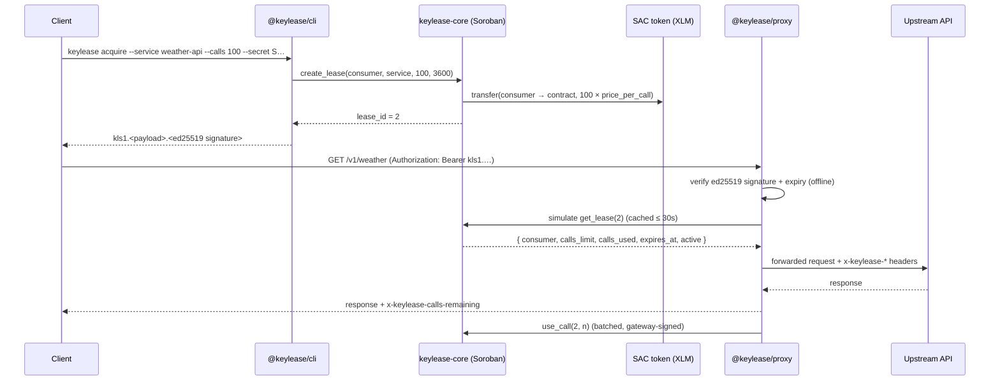

# keylease-gateway

[](https://github.com/KeyLease-Security/keylease-gateway/actions/workflows/ci.yml)
[](./LICENSE)
[](https://nodejs.org)
[](https://pnpm.io)
[](https://www.typescriptlang.org/)
[](https://soroban.stellar.org)
[](https://stellar.expert/explorer/testnet/contract/CC2YHTV3ZOFZJGQ5ACJAZRY46JDAF4ZUWOBMFZTSMQAFIW4UOXDA3KRC)

KeyLease sells **prepaid, per-call API access on Stellar**. A provider registers a
priced service on the Soroban contract, a consumer prepays a lease with real
XLM, and an edge proxy admits requests only while that lease still has calls
left on chain.

Everything the system depends on is Soroban:

| Layer | What it does on Stellar |
| --- | --- |
| [`contracts/keylease-core`](./contracts/keylease-core) | Soroban registry: services, prepaid leases, **escrow**, on-chain quota, provider payout + consumer refund |
| [`@keylease/cli`](./packages/cli) | Signs `create_lease` (paying the SAC token) and mints ed25519 session tokens; `settle`/`revoke` release escrow |
| [`@keylease/proxy`](./packages/proxy) | Verifies session tokens offline, reads lease state by **simulating** `get_lease`, and commits served calls with `use_call` |

```
contracts/keylease-core  →  Soroban contract (Rust, soroban-sdk 29)
packages/cli             →  @keylease/cli     acquire / env / status / settle / revoke
packages/proxy           →  @keylease/proxy   lease-verifying reverse proxy
```

**Deployed on Stellar Testnet:**
[`CC2YHTV3ZOFZJGQ5ACJAZRY46JDAF4ZUWOBMFZTSMQAFIW4UOXDA3KRC`](https://stellar.expert/explorer/testnet/contract/CC2YHTV3ZOFZJGQ5ACJAZRY46JDAF4ZUWOBMFZTSMQAFIW4UOXDA3KRC)
(see [Deployments](#deployments))

---

## Architecture

```
 ┌──────────┐
 │ Client   │  1. keylease acquire --service weather-api --calls 100
 │ (dev /   │
 │  CI job) │
 └────┬─────┘
      │  2. create_lease(consumer, service, calls, duration)   ┌──────────────────────────────┐
      ├───────────────────────────────────────────────────────▶│        keylease-core         │
      │      consumer signs; contract pulls escrow:            │  (Soroban, Rust, this repo)  │
      │      calls × price_per_call  (SAC token)               │                              │
      │                                                        │  services · leases · escrow  │
      │  3. u64 lease id ◀─────────────────────────────────────│  use_call · settle · revoke  │
      │                                                        └──────────────┬───────────────┘
      │  4. keylease acquire mints                             ▲              │
      │     kls1.<payload>.<ed25519 sig>                       │              │
      ▼                                                        │ 6. get_lease │ 8. use_call
 ┌──────────────────────────────┐                              │  (simulate)  │  (gateway
 │  5. GET /v1/weather          │                              │              │   commits)
 │     Authorization: Bearer …  │                              │              │
 └──────────────┬───────────────┘                              │              │
                ▼                                              │              │
 ┌─────────────────────────────────────────────┐               │              │
 │            @keylease/proxy                  │───────────────┘              │
 │  7. verify token signature + expiry offline │                              │
 │  9. check active / expiry / quota on chain  │──────────────────────────────┘
 │ 10. local counter + batched quota commits   │
 │ 11. forward only allowed requests           │
 └──────────────────┬──────────────────────────┘
                    ▼
           ┌─────────────────┐
           │  Upstream API   │   ← never sees an unverified request
           └─────────────────┘
```



### Why it is shaped this way

- **Access is prepaid on chain.** `create_lease` is not a registry write: it
  transfers `calls × price_per_call` of the configured SAC token from the
  consumer into the contract's escrow. A lease therefore cannot exist without
  the consumer having paid for it, and the provider cannot be paid twice.
- **Settlement is deterministic.** `settle` (permissionless after expiry or
  quota exhaustion) pays `provider = price_paid × calls_used / calls_limit` and
  refunds the remainder to the consumer. `revoke` does the same for the unused
  calls immediately, with the consumer's authorisation.
- **Quota is enforced on chain, not just in memory.** A proxy's local counter
  is only a fast path; running a second proxy would otherwise mint free quota.
  The gateway account commits served calls with `use_call`, so `calls_used` on
  chain reflects real traffic and every instance sees the same remaining quota.
- **The signature check is offline.** A bearer token is
  `kls1.<base64url(payload)>.<ed25519 signature>` where the payload carries
  `(v, lease_id, consumer, iat, exp)` and the signature is produced by the
  consumer's Stellar key. Forged or expired tokens never reach the RPC layer.
- **Reads go through simulation.** Lease state is read by simulating
  `get_lease` over Soroban RPC rather than poking at raw contract storage, so
  the proxy follows the contract's ABI instead of its storage layout, and
  contract errors (`Error(Contract, #5)`) map to precise HTTP decisions.
- **Long-lived entries are bumped.** Leases and services are persistent
  entries with TTL extension, so a lease does not disappear from state while it
  is still payable.

---

## Quickstart

```bash
pnpm install
pnpm build

# The contract is already deployed on testnet:
export KEYLEASE_CONTRACT_ID=CC2YHTV3ZOFZJGQ5ACJAZRY46JDAF4ZUWOBMFZTSMQAFIW4UOXDA3KRC

# 1. inspect the demo lease created at deploy time (25 prepaid calls)
node packages/cli/dist/index.js status --lease 1

# 2. prepay your own lease (needs a funded testnet account + XLM)
node packages/cli/dist/index.js acquire \
  --service weather-api --calls 25 --duration 3600 --secret "$STELLAR_SECRET"

# 3. write the session keys for shell/CI use
node packages/cli/dist/index.js env --service weather-api

# 4. run the proxy in front of the protected API
export KEYLEASE_UPSTREAM_URL=https://api.example.com
export KEYLEASE_GATEWAY_SECRET="$KEYLEASE_GATEWAY_SECRET"   # registered gateway
node packages/proxy/dist/index.js

# 5. call through it
curl -H "Authorization: Bearer $KEYLEASE_SESSION_TOKEN" http://localhost:8080/v1/weather
#   < x-keylease-lease-id: 2
#   < x-keylease-calls-remaining: 24

# 6. settle the lease after it expires (pays provider, refunds the rest)
node packages/cli/dist/index.js settle --lease 2 --secret "$STELLAR_SECRET"
```

Offline sanity check of a token (no RPC required):

```bash
node packages/cli/dist/index.js status --token "$KEYLEASE_SESSION_TOKEN"
```

Redeploying the contract from source (needs Rust + `stellar-cli` ≥ 25.2):

```bash
pnpm contract:test          # 14 Rust tests against a real SAC instance
pnpm contract:build         # wasm32v1-none artifact
pnpm deploy:testnet         # upload → create → init → register → demo lease
```

The deploy script funds fresh admin/gateway/provider/consumer accounts through
friendbot, writes `deployments.json` (public) and
`.keylease/testnet-accounts.json` (git-ignored secret seeds).

---

## CLI reference

| Command | Purpose |
| --- | --- |
| `keylease acquire --service <id> --calls <n> --duration <secs> --secret <key>` | Invokes `create_lease` (paying the SAC token into escrow) and prints a signed session bearer token |
| `keylease env --service <id> [--file .env]` | Writes the temporary keys of an acquired lease into a local `.env` |
| `keylease status --lease <id>` | Reads live lease state by simulating `get_lease` |
| `keylease status --token <token>` | Verifies a session token offline |
| `keylease settle --lease <id> --secret <key>` | Settles an expired/exhausted lease: provider payout + consumer refund |
| `keylease revoke --lease <id> --secret <key>` | Ends a lease early and refunds its unused calls |
| `keylease help` · `keylease --version` | Help / version |

Common flags: `--network testnet|mainnet|local`, `--rpc <url>`,
`--contract <id>`, `--json` (machine-readable output).

`--secret` is the consumer account's **Stellar secret seed**. It signs the
`create_lease` transaction and the session token, and it never leaves the
process — it is not printed, logged, or written to disk.

`acquire` remembers the lease in `.keylease/sessions.json` (git-ignored) so
`env` can find it later. `env` merges these keys, replacing existing ones and
preserving everything else in the file:

```
KEYLEASE_SERVICE KEYLEASE_LEASE_ID KEYLEASE_CONSUMER KEYLEASE_SESSION_TOKEN
KEYLEASE_CALLS_LIMIT KEYLEASE_ISSUED_AT KEYLEASE_EXPIRES_AT
```

---

## Contract reference

`contracts/keylease-core` is a Soroban contract (`soroban-sdk` 29, built for
`wasm32v1-none`, 13.8 KB wasm).

| Entry point | Auth | Description |
| --- | --- | --- |
| `init(admin, token, gateway)` | admin | One-time setup with the escrow token (native SAC) and the gateway account |
| `set_gateway(gateway)` | admin | Rotate the account allowed to commit quota |
| `register_service(provider, service, price_per_call)` | provider | Register or re-price a service (`price_per_call > 0`) |
| `set_service_active(provider, service, active)` | provider | Pause / resume a service |
| `quote(service, calls)` | – | Price of a batch in token smallest units |
| `create_lease(consumer, service, calls, duration)` | consumer | Pulls `calls × price_per_call` into escrow, returns `u64` lease id |
| `use_call(lease_id, count)` | gateway | Commits served calls (clamped at `calls_limit`) |
| `revoke(lease_id)` | consumer | Refunds unused calls immediately |
| `settle(lease_id)` | – (permissionless) | After expiry/exhaustion: pays provider, refunds consumer |
| `get_lease(id)` · `get_service(id)` · `get_config()` · `remaining_calls(id)` | – | Views used by the CLI and proxy |

Storage: `Config` in instance storage; `Service(String)` and `Lease(u64)` as
persistent entries with TTL bumps (`MIN_TTL` 7 days, `EXTEND_TO` 30 days).
Events: `init`, `gateway`, `service_registered`, `lease_created`,
`calls_committed`, `lease_revoked`, `lease_settled`.

Contract failures are typed (`Error` enum) and surface in the CLI/proxy as
`Error(Contract, #n)`:

| Code | Variant | Meaning |
| --- | --- | --- |
| 3 | `UnknownService` | Service id was never registered |
| 4 | `ServiceInactive` | Service paused by its provider |
| 5 | `LeaseNotFound` | No lease with that id (proxy → `403 lease_not_found`) |
| 6 | `LeaseInactive` | Lease revoked or settled |
| 7 | `LeaseExpired` | Lease past `expires_at` |
| 8 | `LeaseNotSettleable` | `settle` before expiry/exhaustion |
| 9 | `AlreadySettled` | Escrow already paid out |
| 10–13 | `InvalidCalls`, `InvalidDuration`, `InvalidPrice`, `InvalidAmount` | Argument validation |

Escrow invariant: the contract only ever pays out `price_paid` once per lease,
split as `used/total` to the provider and `(total-used)/total` to the consumer.

---

## Proxy configuration

| Variable | Required | Default | Description |
| --- | --- | --- | --- |
| `KEYLEASE_UPSTREAM_URL` | yes | – | Protected API base URL (path prefixes are preserved) |
| `KEYLEASE_CONTRACT_ID` | yes | – | `keylease-core` contract id |
| `KEYLEASE_NETWORK` | no | `testnet` | `testnet` \| `mainnet` \| `local` |
| `KEYLEASE_RPC_URL` | no | network default | Soroban RPC endpoint override |
| `KEYLEASE_GATEWAY_SECRET` | no | – | Seed of the registered gateway; enables on-chain `use_call` commits. Omit to enforce quota locally only |
| `KEYLEASE_QUOTA_BATCH` | no | `50` | Buffered calls before committing on chain |
| `KEYLEASE_QUOTA_FLUSH_MS` | no | `10000` | Periodic quota commit interval |
| `KEYLEASE_CACHE_TTL_MS` | no | `30000` | Lease-state cache TTL |
| `KEYLEASE_FORWARD_AUTH` | no | `false` | Forward the caller's bearer token upstream |
| `PORT` / `HOST` | no | `8080` / `0.0.0.0` | Listen address |

### Responses

| Status | Meaning |
| --- | --- |
| `401 missing_token` / `invalid_token` / `token_expired` | Bearer token absent, malformed, forged or expired |
| `403 lease_not_found` / `lease_inactive` / `lease_expired` / `consumer_mismatch` | On-chain lease does not permit this call |
| `403 quota_exhausted` | The lease's call limit has been spent (on chain, locally, or both) |
| `503 verification_unavailable` | Soroban RPC could not be reached (fail closed) |
| `502 bad_gateway` / `504 gateway_timeout` | Upstream failure (only after the lease passed) |

Allowed responses carry `x-keylease-lease-id` and `x-keylease-calls-remaining`.

---

## Deployments

Nothing in this project holds mainnet value until an audit is announced (see
[SECURITY.md](./SECURITY.md)). Current deployment status:

| Component | Network / host | Address or URL |
| --- | --- | --- |
| `keylease-core` contract | Stellar Testnet | [`CC2YHTV3ZOFZJGQ5ACJAZRY46JDAF4ZUWOBMFZTSMQAFIW4UOXDA3KRC`](https://stellar.expert/explorer/testnet/contract/CC2YHTV3ZOFZJGQ5ACJAZRY46JDAF4ZUWOBMFZTSMQAFIW4UOXDA3KRC) |
| Escrow token | Stellar Testnet | native SAC `CDLZFC3SYJYDZT7K67VZ75HPJVIEUVNIXF47ZG2FB2RMQQVU2HHGCYSC` |
| Registered service | Stellar Testnet | `weather-api` @ `1000` stroops / call |
| Demo lease | Stellar Testnet | lease `1` — 25 calls prepaid (25 000 stroops escrow) |
| Reference `@keylease/proxy` instance | – | Not hosted yet — run locally per [Quickstart](#quickstart) |
| `@keylease/cli` | npm registry | Not published (`@keylease` scope) — install from source per [Development](#development) |

Deployment record (source of truth: [`deployments.json`](./deployments.json)):

| Step | Transaction |
| --- | --- |
| `uploadContractWasm` | [`327114239efac079e49f140014020135829f2c150ad9c9dbf07fdf449613dc47`](https://stellar.expert/explorer/testnet/tx/327114239efac079e49f140014020135829f2c150ad9c9dbf07fdf449613dc47) |
| `createCustomContract` | [`1b94fb4522214f11b1548a54b921af9435b4cb9690474d8d4552c1cb669c6f7f`](https://stellar.expert/explorer/testnet/tx/1b94fb4522214f11b1548a54b921af9435b4cb9690474d8d4552c1cb669c6f7f) |
| `init(admin, token, gateway)` | [`f5ed865b9cebd467f5af645148cca3eae73ad3e11869a63a90bfb92bd4a26c08`](https://stellar.expert/explorer/testnet/tx/f5ed865b9cebd467f5af645148cca3eae73ad3e11869a63a90bfb92bd4a26c08) |
| `register_service(weather-api, 1000)` | [`5d934e16163a52122731ae40b315bb08b4430bc8bd12280f6655c9d1229d54ee`](https://stellar.expert/explorer/testnet/tx/5d934e16163a52122731ae40b315bb08b4430bc8bd12280f6655c9d1229d54ee) |
| `create_lease(consumer, weather-api, 25, 86400)` | [`8aea8f39f4d75adfa76416e2e98b03644acddaf4be449cc145f5253ba29d3db3`](https://stellar.expert/explorer/testnet/tx/8aea8f39f4d75adfa76416e2e98b03644acddaf4be449cc145f5253ba29d3db3) |

Wasm: `b8c0874e05e61a49e5ea2ac9961289946f14260cc036fb34930440c0bc1a30bd`
(13 836 bytes). Public role accounts are listed in `deployments.json`; their
seeds live only in the git-ignored `.keylease/testnet-accounts.json`.

Reproduce from scratch:

```bash
pnpm contract:test && pnpm contract:build && pnpm deploy:testnet
```

---

## Repository layout

```
keylease-gateway/
├── contracts/
│   └── keylease-core/                 # Soroban contract (Rust)
│       ├── Cargo.toml
│       ├── rust-toolchain.toml        # stable + wasm32v1-none
│       └── src/{lib.rs,test.rs}
├── packages/
│   ├── cli/                           # @keylease/cli
│   │   ├── scripts/deploy-testnet.mjs # upload/create/init/register/demo lease
│   │   └── src/{index,token}.ts
│   │       ├── commands/{lease,status,lifecycle}.ts
│   │       └── client/soroban.ts
│   └── proxy/                         # @keylease/proxy
│       └── src/{index,server,verifier,quota,cache}.ts
├── deployments.json                   # testnet contract ids + tx hashes
├── .github/workflows/ci.yml           # TS: lint/build/tsc/test · Rust: cargo test + wasm
├── package.json                       # pnpm scripts: build / test / lint / typecheck / deploy
├── pnpm-workspace.yaml
├── tsconfig.base.json
├── LICENSE (MIT)
├── README.md
└── CONTRIBUTING.md
```

## Development

```bash
pnpm contract:test # cargo test: 14 contract tests
pnpm contract:build# stellar contract build (wasm32v1-none)
pnpm build         # tsc emit for both packages (topological order)
pnpm test          # vitest: 110 tests (58 CLI + 52 proxy)
pnpm lint          # eslint (flat config, typescript-eslint)
pnpm typecheck     # build, then tsc --noEmit in every package
```

TypeScript tests never touch the network: the CLI injects a fake `SorobanRpc`
client, and the proxy injects a fake `LeaseStateProvider`, a fake quota
committer, a fake `fetch` and a fake clock. The contract tests run against a
real SAC instance registered in the Soroban test environment.

### Contract schema used by this repo

```rust
init(admin: Address, token: Address, gateway: Address)
register_service(provider: Address, service: String, price_per_call: i128) -> Service
create_lease(consumer: Address, service: String, calls: u32, duration: u64) -> u64
use_call(lease_id: u64, count: u32) -> Lease
revoke(lease_id: u64) -> Lease
settle(lease_id: u64) -> Lease
```

`Lease` struct: `id, service, provider, consumer, calls_limit, calls_used,
expires_at (unix seconds), active, settled, price_paid (i128)`.

## Contributing

PRs welcome — read [CONTRIBUTING.md](./CONTRIBUTING.md) for setup, coding
conventions and the issue templates (trivial 100 / medium 150 / high 200
points). Found a security issue (token forgery, quota bypass, escrow payout,
RPC spoofing)? Follow [SECURITY.md](./SECURITY.md) instead of opening a public
issue.

## Community

Questions, ideas, or just want to follow along? Open a
[GitHub issue](https://github.com/KeyLease-Security/keylease-gateway/issues) —
everything is tracked in the open.

## Maintainers

| Maintainer | Role | Contact |
| --- | --- | --- |
| [KeyLease-Security](https://github.com/KeyLease-Security) | Project owner | [GitHub issues](https://github.com/KeyLease-Security/keylease-gateway/issues) |

## Contributors

<a href="https://github.com/KeyLease-Security/keylease-gateway/graphs/contributors">
  
</a>

## License

[MIT](./LICENSE)
