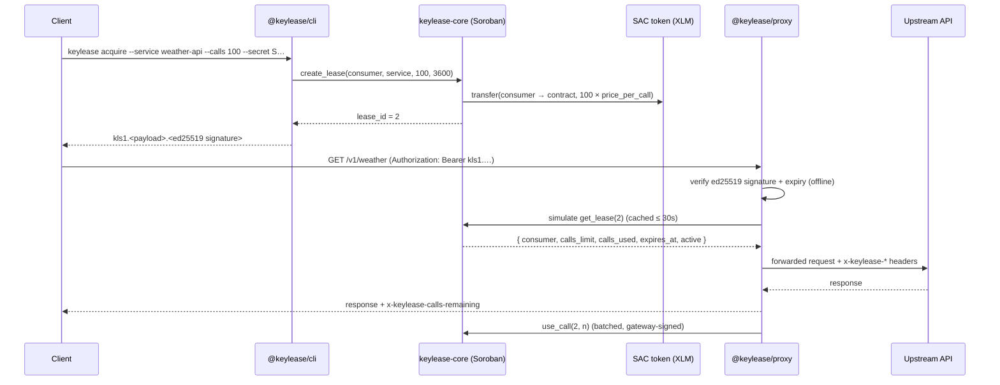
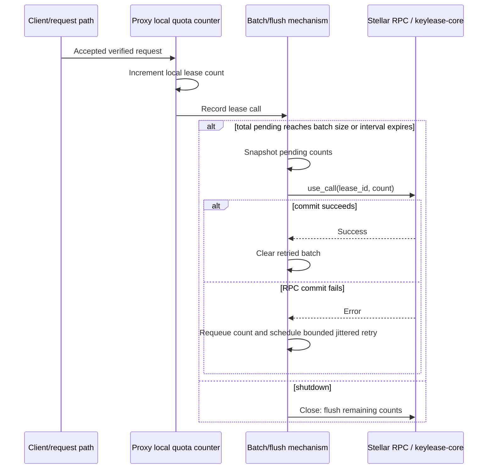

# keylease-gateway

[](https://github.com/KeyLease-Security/keylease-gateway/actions/workflows/ci.yml)
[](./LICENSE)
[](https://nodejs.org)
[](https://pnpm.io)
[](https://www.typescriptlang.org/)
[](https://soroban.stellar.org)
[](https://stellar.expert/explorer/testnet/contract/CC2YHTV3ZOFZJGQ5ACJAZRY46JDAF4ZUWOBMFZTSMQAFIW4UOXDA3KRC)

<!-- Recording placeholder: replace with the hosted ~2-minute testnet demo. -->
[▶ Watch the end-to-end demo](./docs/media/demo.mp4)

KeyLease sells **prepaid, per-call API access on Stellar**. A provider registers a
priced service on the Soroban contract, a consumer prepays a lease with real
XLM, and an edge proxy admits requests only while that lease still has calls
left on chain.

Everything the system depends on is Soroban:

| Layer | What it does on Stellar |
| --- | --- |
| [`contracts/keylease-core`](./contracts/keylease-core) | Soroban registry: services, prepaid leases, **escrow**, on-chain quota, provider payout + consumer refund |
| [`@keylease/cli`](./packages/cli) | Signs `create_lease` (paying the SAC token) and mints ed25519 session tokens; `settle`/`revoke` release escrow |
| [`@keylease/proxy`](./packages/proxy) | Verifies session tokens offline, reads lease state by **simulating** `get_lease`, and commits served calls with `use_call` |

```
contracts/keylease-core  →  Soroban contract (Rust, soroban-sdk 29)
packages/cli             →  @keylease/cli     acquire / env / status / sessions / settle / revoke
packages/proxy           →  @keylease/proxy   lease-verifying reverse proxy
```

**Deployed on Stellar Testnet:**
[`CC2YHTV3ZOFZJGQ5ACJAZRY46JDAF4ZUWOBMFZTSMQAFIW4UOXDA3KRC`](https://stellar.expert/explorer/testnet/contract/CC2YHTV3ZOFZJGQ5ACJAZRY46JDAF4ZUWOBMFZTSMQAFIW4UOXDA3KRC)
(see [Deployments](#deployments))

---

## Architecture

```
 ┌──────────┐
 │ Client   │  1. keylease acquire --service weather-api --calls 100
 │ (dev /   │
 │  CI job) │
 └────┬─────┘
      │  2. create_lease(consumer, service, calls, duration)   ┌──────────────────────────────┐
      ├───────────────────────────────────────────────────────▶│        keylease-core         │
      │      consumer signs; contract pulls escrow:            │  (Soroban, Rust, this repo)  │
      │      calls × price_per_call  (SAC token)               │                              │
      │                                                        │  services · leases · escrow  │
      │  3. u64 lease id ◀─────────────────────────────────────│  use_call · settle · revoke  │
      │                                                        └──────────────┬───────────────┘
      │  4. keylease acquire mints                             ▲              │
      │     kls1.<payload>.<ed25519 sig>                       │              │
      ▼                                                        │ 6. get_lease │ 8. use_call
 ┌──────────────────────────────┐                              │  (simulate)  │  (gateway
 │  5. GET /v1/weather          │                              │              │   commits)
 │     Authorization: Bearer …  │                              │              │
 └──────────────┬───────────────┘                              │              │
                ▼                                              │              │
 ┌─────────────────────────────────────────────┐               │              │
 │            @keylease/proxy                  │───────────────┘              │
 │  7. verify token signature + expiry offline │                              │
 │  9. check active / expiry / quota on chain  │──────────────────────────────┘
 │ 10. local counter + batched quota commits   │
 │ 11. forward only allowed requests           │
 └──────────────────┬──────────────────────────┘
                    ▼
           ┌─────────────────┐
           │  Upstream API   │   ← never sees an unverified request
           └─────────────────┘
```



### Why it is shaped this way

- **Access is prepaid on chain.** `create_lease` is not a registry write: it
  transfers `calls × price_per_call` of the configured SAC token from the
  consumer into the contract's escrow. A lease therefore cannot exist without
  the consumer having paid for it, and the provider cannot be paid twice.
- **Settlement is deterministic.** `settle` (permissionless after expiry or
  quota exhaustion) pays `provider = price_paid × calls_used / calls_limit` and
  refunds the remainder to the consumer. `revoke` does the same for the unused
  calls immediately, with the consumer's authorisation.
- **Quota is enforced on chain, not just in memory.** A proxy's local counter
  is only a fast path; running a second proxy would otherwise mint free quota.
  The gateway account commits served calls with `use_call`, so `calls_used` on
  chain reflects real traffic and every instance sees the same remaining quota.
- **The signature check is offline.** A bearer token is
  `kls1.<base64url(payload)>.<ed25519 signature>` where the payload carries
  `(v, lease_id, consumer, iat, exp)` and the signature is produced by the
  consumer's Stellar key. Forged or expired tokens never reach the RPC layer.
- **Reads go through simulation.** Lease state is read by simulating
  `get_lease` over Soroban RPC rather than poking at raw contract storage, so
  the proxy follows the contract's ABI instead of its storage layout, and
  contract errors (`Error(Contract, #5)`) map to precise HTTP decisions.
- **Long-lived entries are bumped.** Leases and services are persistent
  entries whose TTL is extended on every write **and** every read, so a lease
  does not disappear from state while it is still payable, even if it is only
  ever read (the proxy's `get_lease` path).

---

## Quota batching and on-chain reconciliation

The proxy has two quota views:

- **Locally observed usage** is maintained in memory by `LeaseVerifier`. Each
  served, accepted request increments that process's counter immediately.
- **On-chain committed usage** is maintained by the Soroban contract as
  `calls_used`. A configured gateway key is required for batched `use_call`
  commits.

The local counter is the fast path: it admits traffic without waiting for an
RPC round trip. It is not durable and is not a substitute for the lease's
on-chain state.

When a gateway secret is configured, the proxy queues one count per lease.
The queue flushes when the **total pending count across leases reaches 50**,
after a **10-second interval**, when the tracked-lease bound triggers an early
flush, or during shutdown's `close()` drain. Operators can override the batch
size and interval with `KEYLEASE_QUOTA_BATCH` and `KEYLEASE_QUOTA_FLUSH_MS`.
Each flush snapshots pending counts and issues a separate `use_call(lease_id,
count)` for each lease. Commits are serialized and are fire-and-forget from
the client request path: the request has already been admitted and returned
without waiting for commit success.

If an RPC commit fails, that lease's count is returned to the pending map and
`onError` logs it. The implementation schedules jittered exponential retry
backoff (1-second base, 30-second cap by default) and makes at most five total
commit attempts per pending batch. Later local traffic is added to requeued
pending usage, so a later successful commit can include both earlier and newly
observed calls. Repeated failure does not turn local usage into an HTTP 5xx,
and the on-chain lease remains authoritative for settlement.

There is an explicit crash window: the verifier counter and quota batch map
live only in process memory. Calls observed since the last successful commit
can be lost if the process exits unexpectedly or restarts; pending usage is
not guaranteed to survive. Graceful close attempts to flush remaining counts,
but a forced process termination or unavailable RPC may leave committed usage
behind. The new process starts with an empty local counter and reads the
lease's last committed on-chain state, so a restart may temporarily permit
usage that is not yet reflected in a newly started or rebuilt counter.

Multiple proxy instances do not share a local counter or in-process retry
queue. Each instance admits from `max(on-chain calls_used, local_calls)` and
its own counter only. They can therefore have independent over-admission
windows and may batch separate `use_call` calls for the same lease. The contract
receives and applies gateway-authorized commits; concurrent instances are
not assigned disjoint call ranges. Operators should use the on-chain
`calls_used` value and reconciliation procedures as the source of truth.

An operator can reconcile usage with `use_call`. This is typically done with
the gateway account configured for the proxy and the count representing usage
known to be missing from `calls_used`. Before invoking it, obtain the observed
request usage and check the lease's on-chain state; avoid resubmitting a batch
that may already have committed. An already-observed call that was later
committed by one or more proxies must not be counted twice. The contract's
settlement calculation uses on-chain `calls_used`, while local counters affect
only each proxy process's admission decisions until their commits succeed.



---

## Quickstart

<!-- Generated from scripts/demo/quickstart.sh; placeholder until the GIF is recorded. -->


```bash
pnpm install
pnpm build

# The contract is already deployed on testnet:
export KEYLEASE_CONTRACT_ID=CC2YHTV3ZOFZJGQ5ACJAZRY46JDAF4ZUWOBMFZTSMQAFIW4UOXDA3KRC

# 1. inspect the demo lease created at deploy time (25 prepaid calls)
node packages/cli/dist/index.js status --lease 1

# 2. prepay your own lease (needs a funded testnet account + XLM)
node packages/cli/dist/index.js acquire \
  --service weather-api --calls 25 --duration 3600 --secret "$STELLAR_SECRET"

# 3. write the session keys for shell/CI use
node packages/cli/dist/index.js env --service weather-api

# 4. run the proxy in front of the protected API
export KEYLEASE_UPSTREAM_URL=https://api.example.com
export KEYLEASE_GATEWAY_SECRET="$KEYLEASE_GATEWAY_SECRET"   # registered gateway
node packages/proxy/dist/index.js

# 5. call through it
curl -H "Authorization: Bearer $KEYLEASE_SESSION_TOKEN" http://localhost:8080/v1/weather
#   < x-keylease-lease-id: 2
#   < x-keylease-calls-remaining: 24

# 6. settle the lease after it expires (pays provider, refunds the rest)
node packages/cli/dist/index.js settle --lease 2 --secret "$STELLAR_SECRET"
```

### Record the demo

The local demo script acquires a five-call **testnet** lease, writes its session
keys to a private temporary `.env`, starts a local mock upstream and proxy, then
shows one allowed request and one rejected forged token. It prompts for the
funded testnet secret without echoing it, suppresses the CLI's token output, and
never needs or displays a mainnet key. The prepaid testnet lease remains on
chain after the local processes stop.

For the animated quickstart, install `asciinema` and
[`agg`](https://github.com/asciinema/agg), then record without enabling stdin
capture:

```bash
mkdir -p docs/media
asciinema rec docs/media/quickstart.cast
# In the recorded shell:
bash scripts/demo/quickstart.sh
# Exit the recorded shell, then render the GIF:
agg docs/media/quickstart.cast docs/media/quickstart.gif
```

For the video, record `bash scripts/demo/quickstart.sh` in OBS while narrating
the flow, save it as `docs/media/demo.mp4`, and replace the placeholder link
above with the hosted video URL before publishing. Suggested caption / pinned
comment commands:

```text
keylease acquire --network testnet --contract <testnet-contract-id> --service weather-api --calls 5 --duration 3600 --secret [hidden]
keylease env --service weather-api --file .env
KEYLEASE_UPSTREAM_URL=http://localhost:<local-upstream-port> node packages/proxy/dist/index.js
curl -i -H "Authorization: Bearer [session token]" http://localhost:<proxy-port>/v1/weather
curl -i -H "Authorization: Bearer kls1.forged.invalid" http://localhost:<proxy-port>/v1/weather
```

Offline sanity check of a token (no RPC required):

```bash
node packages/cli/dist/index.js status --token "$KEYLEASE_SESSION_TOKEN"
```

Redeploying the contract from source (needs Rust + `stellar-cli` ≥ 25.2):

```bash
pnpm contract:test          # 14 Rust tests against a real SAC instance
pnpm contract:build         # wasm32v1-none artifact
pnpm deploy:testnet         # upload → create → init → register → demo lease
```

The deploy script funds fresh admin/gateway/provider/consumer accounts through
friendbot, writes `deployments.json` (public) and
`.keylease/testnet-accounts.json` (git-ignored secret seeds).

---

## CLI reference

| Command | Purpose |
| --- | --- |
| `keylease acquire --service <id> --calls <n> --duration <secs> --secret <key>` | Invokes `create_lease` (paying the SAC token into escrow) and prints a signed session bearer token |
| `keylease env --service <id> [--file .env]` | Writes the temporary keys of an acquired lease into a local `.env` |
| `keylease status --lease <id>` | Reads live lease state by simulating `get_lease` |
| `keylease status --token <token>` | Verifies a session token offline |
| `keylease status --token <token> --check-chain [--json]` | Also checks the referenced lease's on-chain active state, consumer, and remaining quota |
| `keylease sessions [--json]` | Lists locally stored leases with expiry and status |
| `keylease sessions --prune [--json]` | Removes locally stored leases that have expired |
| `keylease settle --lease <id> --secret <key>` | Settles an expired/exhausted lease: provider payout + consumer refund |
| `keylease revoke --lease <id> --secret <key>` | Ends a lease early and refunds its unused calls |
| `keylease help` · `keylease --version` | Help / version |

Common flags: `--network testnet|mainnet|local`, `--rpc <url>`,
`--contract <id>`, `--json` (machine-readable output).

`status --token` checks the token signature and expiry offline. Add
`--check-chain` to also simulate `get_lease` and check that the lease is active,
belongs to the token's consumer, and has calls remaining. The result includes
the on-chain service; service and call limits are not claims encoded in the
current session token. Chain lookup failures are reported as failed checks and
return exit code 1.

`--secret` is the consumer account's **Stellar secret seed**. It signs the
`create_lease` transaction and the session token, and it never leaves the
process — it is not printed, logged, or written to disk.

`acquire` remembers the lease in `.keylease/sessions.json` (git-ignored) so
`env` can find it later. The store is a local cache with best-effort locking:
writes are serialized within a process, guarded across processes by an
exclusive `.keylease/sessions.json.lock` (2 s wait; a lock older than 10 s is
treated as abandoned and removed once), and land via an atomic temp-file
rename, so parallel `acquire` runs for different services keep every session.
If the lock stays held, the command fails with a `locked` error naming the
lock file. `env` merges these keys, replacing existing ones and
preserving everything else in the file:

```
KEYLEASE_SERVICE KEYLEASE_LEASE_ID KEYLEASE_CONSUMER KEYLEASE_SESSION_TOKEN
KEYLEASE_CALLS_LIMIT KEYLEASE_ISSUED_AT KEYLEASE_EXPIRES_AT
```

`keylease sessions` lists the stored service, lease ID, expiry, and whether the
lease is active or expired. Add `--json` for machine-readable output, or
`--prune` to remove expired entries. If the session store is missing, acquire a
lease first; if it is corrupt, back it up or repair it before retrying.

---

## Contract reference

`contracts/keylease-core` is a Soroban contract (`soroban-sdk` 29, built for
`wasm32v1-none`, 13.8 KB wasm).

| Entry point | Auth | Description |
| --- | --- | --- |
| `init(admin, token, gateway)` | admin | One-time setup with the escrow token (native SAC) and the gateway account |
| `set_gateway(gateway)` | admin | Rotate the account allowed to commit quota |
| `propose_admin(new_admin)` | admin | Nominate the next admin; nothing changes until the nominee accepts |
| `accept_admin()` | pending admin | Complete a handover (the nominee must authorise) and clear the pending slot |
| `register_service(provider, service, price_per_call)` | provider | Register or re-price a service (`price_per_call > 0`) |
| `set_service_active(provider, service, active)` | provider | Pause / resume a service |
| `quote(service, calls)` | – | Price of a batch in token smallest units |
| `create_lease(consumer, service, calls, duration)` | consumer | Pulls `calls × price_per_call` into escrow, returns `u64` lease id. `consumer` must not be the contract itself |
| `use_call(lease_id, count)` | gateway | Commits served calls (clamped at `calls_limit`); emits `calls_committed` with `(calls_used, remaining)` |
| `revoke(lease_id)` | consumer | Refunds unused calls immediately |
| `settle(lease_id)` | – (permissionless) | After expiry/exhaustion: pays provider, refunds consumer |
| `get_lease(id)` · `get_service(id)` · `get_config()` · `remaining_calls(id)` | – | Views used by the CLI and proxy |
| `version()` | – | Contract ABI version as a `String`, equal to the crate version in `Cargo.toml`; callable before `init` |

`version()` follows semver on the contract ABI: **patch** for internal fixes
with no interface change, **minor** for additive changes (new entry points,
views, error variants or events), **major** for breaking changes (removed or
renamed entry points, changed arguments or storage layout). Bump
`contracts/keylease-core/Cargo.toml` with every contract change; clients should
refuse a major version they do not recognise.

Storage: `Config` and the pending admin (`PendingAdmin`, set by
`propose_admin`) in instance storage; `Service(String)` and `Lease(u64)` as
persistent entries with TTL bumps (`MIN_TTL` 7 days, `EXTEND_TO` 30 days).
The bump happens on writes (`register_service`, `create_lease`, `use_call`, …)
and on reads: `load_config`, `load_service` and `load_lease` extend the entry
when its TTL falls below `MIN_TTL`, so a lease that is only ever simulated or
read stays alive. `extend_ttl` is a no-op above the threshold, so the hot read
path costs one storage access and no write.
Events: `init`, `gateway`, `admin_proposed`, `admin_changed`,
`service_registered`, `lease_created`, `calls_committed`, `lease_revoked`,
`lease_settled`.

`calls_committed` keeps its `(calls_committed, consumer, lease_id)` topic
tuple, so existing topic filters still match, but its payload is now the pair
`(calls_used, remaining)`. Both fields are `u32`; indexers that decoded a bare
`calls_used` value must read the pair (or the first element).

Contract failures are typed (`Error` enum) and surface in the CLI/proxy as
`Error(Contract, #n)`:

| Code | Variant | Meaning |
| --- | --- | --- |
| 3 | `UnknownService` | Service id was never registered |
| 4 | `ServiceInactive` | Service paused by its provider |
| 5 | `LeaseNotFound` | No lease with that id (proxy → `403 lease_not_found`) |
| 6 | `LeaseInactive` | Lease revoked or settled |
| 7 | `LeaseExpired` | Lease past `expires_at` |
| 8 | `LeaseNotSettleable` | `settle` before expiry/exhaustion |
| 9 | `AlreadySettled` | Escrow already paid out |
| 10–13 | `InvalidCalls`, `InvalidDuration`, `InvalidPrice`, `InvalidAmount` | Argument validation |
| 15 | `InvalidConsumer` | `create_lease` consumer is the contract's own address |

Escrow invariant: the contract only ever pays out `price_paid` once per lease,
split as `used/total` to the provider and `(total-used)/total` to the consumer.

---

## Proxy configuration

| Variable | Required | Default | Description |
| --- | --- | --- | --- |
| `KEYLEASE_UPSTREAM_URL` | yes | – | Protected API base URL (path prefixes are preserved) |
| `KEYLEASE_CONTRACT_ID` | yes | – | `keylease-core` contract id |
| `KEYLEASE_NETWORK` | no | `testnet` | `testnet` \| `mainnet` \| `local` |
| `KEYLEASE_RPC_URL` | no | network default | Soroban RPC endpoint override |
| `KEYLEASE_GATEWAY_SECRET` | no | – | Seed of the registered gateway; enables on-chain `use_call` commits. Omit to enforce quota locally only |
| `KEYLEASE_QUOTA_BATCH` | no | `50` | Buffered calls before committing on chain |
| `KEYLEASE_QUOTA_FLUSH_MS` | no | `10000` | Periodic quota commit interval |
| `KEYLEASE_CACHE_TTL_MS` | no | `30000` | Lease-state cache TTL |
| `KEYLEASE_MAX_BODY_BYTES` | no | `33554432` (32 MiB) | Maximum allowed request body size in bytes |
| `KEYLEASE_TRUST_PROXY` | no | `false` | Trusted edge proxies for `x-forwarded-*`: `true`, a hop count, or a comma-separated IP/CIDR list. When off, inbound `x-forwarded-*` headers are dropped and rebuilt from the socket |
| `KEYLEASE_MAX_INFLIGHT` | no | `1024` | Maximum concurrent proxied requests. Excess requests get `503` with `Retry-After: 1` before any quota is charged; `0` disables the cap |
| `KEYLEASE_FORWARD_AUTH` | no | `false` | Forward the caller's bearer token upstream |
| `KEYLEASE_METRICS_ENABLED` | no | `false` | Expose Prometheus metrics on `/metrics` |
| `KEYLEASE_SHUTDOWN_TIMEOUT_MS` | no | `10000` | Graceful shutdown drain timeout in milliseconds |
| `PORT` / `HOST` | no | `8080` / `0.0.0.0` | Listen address |

The on-chain quota sink tracks at most 10,000 distinct leases in its pending batch by default. It flushes pending calls early when that bound is reached.

### Responses

| Status | Meaning |
| --- | --- |
| `200` | Health check (`/healthz`) or readiness probe (`/readyz`) |
| `401 missing_token` / `invalid_token` / `token_expired` | Bearer token absent, malformed, forged or expired |
| `403 lease_not_found` / `lease_inactive` / `lease_expired` / `consumer_mismatch` | On-chain lease does not permit this call |
| `403 quota_exhausted` | The lease's call limit has been spent (on chain, locally, or both) |
| `503 verification_unavailable` | Soroban RPC could not be reached (fail closed) or `/readyz` has no reachable state. Includes `Retry-After`, rounded up from the configured cache TTL and capped at 30 seconds |
| `426 upgrade_required` | `Connection: upgrade` requests (e.g. WebSocket) are not supported; rejected before verification, so no call is consumed. The response carries `Upgrade: HTTP/1.1` |
| `502 bad_gateway` / `504 gateway_timeout` | Upstream failure (only after the lease passed) |

Every response carries `x-request-id`: a valid inbound value (1-128 chars of `A-Za-z0-9._:~+=/-`) is reused, anything else is replaced by a generated UUID. It is also forwarded upstream and appears in denial logs.
Allowed responses carry `x-keylease-lease-id` and `x-keylease-calls-remaining`.
Forwarded upstream requests also receive these headers set exclusively by the proxy; any client-supplied `x-keylease-*` headers are stripped to prevent spoofing.
Once lease verification succeeds, the call remains consumed even if the client disconnects or the upstream request fails; aborted calls are not refunded.
`/healthz` and `/readyz` endpoints provide health and readiness probes without requiring bearer tokens and are never forwarded upstream.

---

## Deployments

Nothing in this project holds mainnet value until an audit is announced (see
[SECURITY.md](./SECURITY.md)). Current deployment status:

| Component | Network / host | Address or URL |
| --- | --- | --- |
| `keylease-core` contract | Stellar Testnet | [`CC2YHTV3ZOFZJGQ5ACJAZRY46JDAF4ZUWOBMFZTSMQAFIW4UOXDA3KRC`](https://stellar.expert/explorer/testnet/contract/CC2YHTV3ZOFZJGQ5ACJAZRY46JDAF4ZUWOBMFZTSMQAFIW4UOXDA3KRC) |
| Escrow token | Stellar Testnet | native SAC `CDLZFC3SYJYDZT7K67VZ75HPJVIEUVNIXF47ZG2FB2RMQQVU2HHGCYSC` |
| Registered service | Stellar Testnet | `weather-api` @ `1000` stroops / call |
| Demo lease | Stellar Testnet | lease `1` — 25 calls prepaid (25 000 stroops escrow) |
| Reference `@keylease/proxy` instance | – | Not hosted yet — run locally per [Quickstart](#quickstart) |
| `@keylease/cli` | npm registry | Not published (`@keylease` scope) — install from source per [Development](#development) |

Deployment record (source of truth: [`deployments.json`](./deployments.json)):

| Step | Transaction |
| --- | --- |
| `uploadContractWasm` | [`327114239efac079e49f140014020135829f2c150ad9c9dbf07fdf449613dc47`](https://stellar.expert/explorer/testnet/tx/327114239efac079e49f140014020135829f2c150ad9c9dbf07fdf449613dc47) |
| `createCustomContract` | [`1b94fb4522214f11b1548a54b921af9435b4cb9690474d8d4552c1cb669c6f7f`](https://stellar.expert/explorer/testnet/tx/1b94fb4522214f11b1548a54b921af9435b4cb9690474d8d4552c1cb669c6f7f) |
| `init(admin, token, gateway)` | [`f5ed865b9cebd467f5af645148cca3eae73ad3e11869a63a90bfb92bd4a26c08`](https://stellar.expert/explorer/testnet/tx/f5ed865b9cebd467f5af645148cca3eae73ad3e11869a63a90bfb92bd4a26c08) |
| `register_service(weather-api, 1000)` | [`5d934e16163a52122731ae40b315bb08b4430bc8bd12280f6655c9d1229d54ee`](https://stellar.expert/explorer/testnet/tx/5d934e16163a52122731ae40b315bb08b4430bc8bd12280f6655c9d1229d54ee) |
| `create_lease(consumer, weather-api, 25, 86400)` | [`8aea8f39f4d75adfa76416e2e98b03644acddaf4be449cc145f5253ba29d3db3`](https://stellar.expert/explorer/testnet/tx/8aea8f39f4d75adfa76416e2e98b03644acddaf4be449cc145f5253ba29d3db3) |

Wasm: `b8c0874e05e61a49e5ea2ac9961289946f14260cc036fb34930440c0bc1a30bd`
(13 836 bytes). Public role accounts are listed in `deployments.json`; their
seeds live only in the git-ignored `.keylease/testnet-accounts.json`.

Reproduce from scratch:

```bash
pnpm contract:test && pnpm contract:build && pnpm deploy:testnet
```

---

## Repository layout

```
keylease-gateway/
├── contracts/
│   └── keylease-core/                 # Soroban contract (Rust)
│       ├── Cargo.toml
│       ├── rust-toolchain.toml        # stable + wasm32v1-none
│       └── src/{lib.rs,test.rs}
├── packages/
│   ├── cli/                           # @keylease/cli
│   │   ├── scripts/deploy-testnet.mjs # upload/create/init/register/demo lease
│   │   └── src/{index,token}.ts
│   │       ├── commands/{lease,status,lifecycle}.ts
│   │       └── client/soroban.ts
│   └── proxy/                         # @keylease/proxy
│       └── src/{index,server,verifier,quota,cache}.ts
├── deployments.json                   # testnet contract ids + tx hashes
├── .github/workflows/ci.yml           # TS: lint/build/tsc/test · Rust: cargo test + wasm
├── .github/workflows/security.yml     # PR malware scan (ClamAV) + dependency review
├── .github/workflows/binary-guard.yml # reject PRs that commit binaries or executables
├── package.json                       # pnpm scripts: build / test / lint / typecheck / deploy
├── pnpm-workspace.yaml
├── tsconfig.base.json
├── LICENSE (MIT)
├── README.md
└── CONTRIBUTING.md
```

## Development

```bash
pnpm contract:test # cargo test: 36 contract tests
pnpm contract:build# stellar contract build (wasm32v1-none)
pnpm build         # tsc emit for both packages (topological order)
pnpm test          # vitest: 110 tests (58 CLI + 52 proxy)
pnpm lint          # eslint (flat config, typescript-eslint)
pnpm typecheck     # build, then tsc --noEmit in every package
```

TypeScript tests never touch the network: the CLI injects a fake `SorobanRpc`
client, and the proxy injects a fake `LeaseStateProvider`, a fake quota
committer, a fake `fetch` and a fake clock. The contract tests run against a
real SAC instance registered in the Soroban test environment.

### Contract schema used by this repo

```rust
init(admin: Address, token: Address, gateway: Address)
register_service(provider: Address, service: String, price_per_call: i128) -> Service
create_lease(consumer: Address, service: String, calls: u32, duration: u64) -> u64
use_call(lease_id: u64, count: u32) -> Lease
revoke(lease_id: u64) -> Lease
settle(lease_id: u64) -> Lease
```

`Lease` struct: `id, service, provider, consumer, calls_limit, calls_used,
expires_at (unix seconds), active, settled, price_paid (i128)`.

## Contributing

PRs welcome — read [CONTRIBUTING.md](./CONTRIBUTING.md) for setup, coding
conventions and the issue templates (trivial 100 / medium 150 / high 200
points). Found a security issue (token forgery, quota bypass, escrow payout,
RPC spoofing)? Follow [SECURITY.md](./SECURITY.md) instead of opening a public
issue.

## Community

Questions, ideas, or just want to follow along? Open a
[GitHub issue](https://github.com/KeyLease-Security/keylease-gateway/issues) —
everything is tracked in the open.

## Maintainers

| Maintainer | Role | Contact |
| --- | --- | --- |
| [KeyLease-Security](https://github.com/KeyLease-Security) | Project owner | [GitHub issues](https://github.com/KeyLease-Security/keylease-gateway/issues) |

## Contributors

<a href="https://github.com/KeyLease-Security/keylease-gateway/graphs/contributors">
  
</a>

## License

[MIT](./LICENSE)
