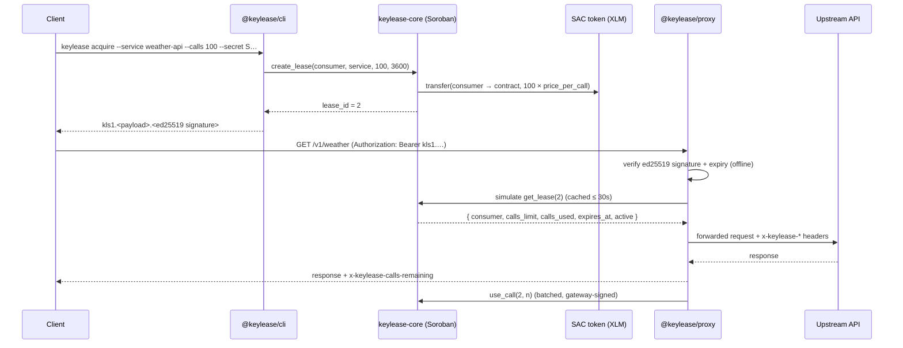

# keylease-gateway

[](https://github.com/KeyLease-Security/keylease-gateway/actions/workflows/ci.yml)
[](./LICENSE)
[](https://nodejs.org)
[](https://pnpm.io)
[](https://www.typescriptlang.org/)
[](https://soroban.stellar.org)
[](https://stellar.expert/explorer/testnet/contract/CC2YHTV3ZOFZJGQ5ACJAZRY46JDAF4ZUWOBMFZTSMQAFIW4UOXDA3KRC)

<!-- Recording placeholder: replace with the hosted ~2-minute testnet demo. -->
[▶ Watch the end-to-end demo](./docs/media/demo.mp4)

KeyLease sells **prepaid, per-call API access on Stellar**. A provider registers a
priced service on the Soroban contract, a consumer prepays a lease with real
XLM, and an edge proxy admits requests only while that lease still has calls
left on chain.

Everything the system depends on is Soroban:

| Layer | What it does on Stellar |
| --- | --- |
| [`contracts/keylease-core`](./contracts/keylease-core) | Soroban registry: services, prepaid leases, **escrow**, on-chain quota, provider payout + consumer refund |
| [`@keylease/cli`](./packages/cli) | Signs `create_lease` (paying the SAC token) and mints ed25519 session tokens; `settle`/`revoke` release escrow |
| [`@keylease/proxy`](./packages/proxy) | Verifies session tokens offline, reads lease state by **simulating** `get_lease`, and commits served calls with `use_call` |

```
contracts/keylease-core  →  Soroban contract (Rust, soroban-sdk 29)
packages/cli             →  @keylease/cli     acquire / env / status / sessions / settle / revoke
packages/proxy           →  @keylease/proxy   lease-verifying reverse proxy
```

**Deployed on Stellar Testnet:**
[`CC2YHTV3ZOFZJGQ5ACJAZRY46JDAF4ZUWOBMFZTSMQAFIW4UOXDA3KRC`](https://stellar.expert/explorer/testnet/contract/CC2YHTV3ZOFZJGQ5ACJAZRY46JDAF4ZUWOBMFZTSMQAFIW4UOXDA3KRC)
(see [Deployments](#deployments))

---

## Architecture

```
 ┌──────────┐
 │ Client   │  1. keylease acquire --service weather-api --calls 100
 │ (dev /   │
 │  CI job) │
 └────┬─────┘
      │  2. create_lease(consumer, service, calls, duration)   ┌──────────────────────────────┐
      ├───────────────────────────────────────────────────────▶│        keylease-core         │
      │      consumer signs; contract pulls escrow:            │  (Soroban, Rust, this repo)  │
      │      calls × price_per_call  (SAC token)               │                              │
      │                                                        │  services · leases · escrow  │
      │  3. u64 lease id ◀─────────────────────────────────────│  use_call · settle · revoke  │
      │                                                        └──────────────┬───────────────┘
      │  4. keylease acquire mints                             ▲              │
      │     kls1.<payload>.<ed25519 sig>                       │              │
      ▼                                                        │ 6. get_lease │ 8. use_call
 ┌──────────────────────────────┐                              │  (simulate)  │  (gateway
 │  5. GET /v1/weather          │                              │              │   commits)
 │     Authorization: Bearer …  │                              │              │
 └──────────────┬───────────────┘                              │              │
                ▼                                              │              │
 ┌─────────────────────────────────────────────┐               │              │
 │            @keylease/proxy                  │───────────────┘              │
 │  7. verify token signature + expiry offline │                              │
 │  9. check active / expiry / quota on chain  │──────────────────────────────┘
 │ 10. local counter + batched quota commits   │
 │ 11. forward only allowed requests           │
 └──────────────────┬──────────────────────────┘
                    ▼
           ┌─────────────────┐
           │  Upstream API   │   ← never sees an unverified request
           └─────────────────┘
```



### Why it is shaped this way

- **Access is prepaid on chain.** `create_lease` is not a registry write: it
  transfers `calls × price_per_call` of the configured SAC token from the
  consumer into the contract's escrow. A lease therefore cannot exist without
  the consumer having paid for it, and the provider cannot be paid twice.
- **Settlement is deterministic.** `settle` (permissionless after expiry or
  quota exhaustion) pays `provider = price_paid × calls_used / calls_limit` and
  refunds the remainder to the consumer. `revoke` does the same for the unused
  calls immediately, with the consumer's authorisation.
- **Quota is enforced on chain, not just in memory.** A proxy's local counter
  is only a fast path; running a second proxy would otherwise mint free quota.
  The gateway account commits served calls with `use_call`, so `calls_used` on
  chain reflects real traffic and every instance sees the same remaining quota.
- **The signature check is offline.** A bearer token is
  `kls1.<base64url(payload)>.<ed25519 signature>` where the payload carries
  `(v, lease_id, consumer, iat, exp)` plus an optional `service` claim, and
  the signature is produced by the consumer's Stellar key. Forged or expired
  tokens never reach the RPC layer (see [Session token payload](#session-token-payload)).
- **Reads go through simulation.** Lease state is read by simulating
  `get_lease` over Soroban RPC rather than poking at raw contract storage, so
  the proxy follows the contract's ABI instead of its storage layout, and
  contract errors (`Error(Contract, #5)`) map to precise HTTP decisions.
- **Long-lived entries are bumped.** Leases and services are persistent
  entries whose TTL is extended on every write **and** every read, so a lease
  does not disappear from state while it is still payable, even if it is only
  ever read (the proxy's `get_lease` path).

---

## Quickstart

<!-- Generated from scripts/demo/quickstart.sh; placeholder until the GIF is recorded. -->


```bash
pnpm install
pnpm build

# The contract is already deployed on testnet:
export KEYLEASE_CONTRACT_ID=CC2YHTV3ZOFZJGQ5ACJAZRY46JDAF4ZUWOBMFZTSMQAFIW4UOXDA3KRC

# 1. inspect the demo lease created at deploy time (25 prepaid calls)
node packages/cli/dist/index.js status --lease 1

# 2. prepay your own lease (needs a funded testnet account + XLM)
node packages/cli/dist/index.js acquire \
  --service weather-api --calls 25 --duration 3600 --secret "$STELLAR_SECRET"

# 3. write the session keys for shell/CI use
node packages/cli/dist/index.js env --service weather-api

# 4. run the proxy in front of the protected API
export KEYLEASE_UPSTREAM_URL=https://api.example.com
export KEYLEASE_GATEWAY_SECRET="$KEYLEASE_GATEWAY_SECRET"   # registered gateway
node packages/proxy/dist/index.js

# 5. call through it
curl -H "Authorization: Bearer $KEYLEASE_SESSION_TOKEN" http://localhost:8080/v1/weather
#   < x-keylease-lease-id: 2
#   < x-keylease-calls-remaining: 24

# 6. settle the lease after it expires (pays provider, refunds the rest)
node packages/cli/dist/index.js settle --lease 2 --secret "$STELLAR_SECRET"
```

### Record the demo

The local demo script acquires a five-call **testnet** lease, writes its session
keys to a private temporary `.env`, starts a local mock upstream and proxy, then
shows one allowed request and one rejected forged token. It prompts for the
funded testnet secret without echoing it, suppresses the CLI's token output, and
never needs or displays a mainnet key. The prepaid testnet lease remains on
chain after the local processes stop.

For the animated quickstart, install `asciinema` and
[`agg`](https://github.com/asciinema/agg), then record without enabling stdin
capture:

```bash
mkdir -p docs/media
asciinema rec docs/media/quickstart.cast
# In the recorded shell:
bash scripts/demo/quickstart.sh
# Exit the recorded shell, then render the GIF:
agg docs/media/quickstart.cast docs/media/quickstart.gif
```

For the video, record `bash scripts/demo/quickstart.sh` in OBS while narrating
the flow, save it as `docs/media/demo.mp4`, and replace the placeholder link
above with the hosted video URL before publishing. Suggested caption / pinned
comment commands:

```text
keylease acquire --network testnet --contract <testnet-contract-id> --service weather-api --calls 5 --duration 3600 --secret [hidden]
keylease env --service weather-api --file .env
KEYLEASE_UPSTREAM_URL=http://localhost:<local-upstream-port> node packages/proxy/dist/index.js
curl -i -H "Authorization: Bearer [session token]" http://localhost:<proxy-port>/v1/weather
curl -i -H "Authorization: Bearer kls1.forged.invalid" http://localhost:<proxy-port>/v1/weather
```

Offline sanity check of a token (no RPC required):

```bash
node packages/cli/dist/index.js status --token "$KEYLEASE_SESSION_TOKEN"
```

Redeploying the contract from source (needs Rust + `stellar-cli` ≥ 25.2):

```bash
pnpm contract:test          # cargo test against a real SAC instance
pnpm contract:build         # wasm32v1-none artifact
pnpm deploy:testnet         # upload → create → init → register → demo lease
```

The deploy script funds fresh admin/gateway/provider/consumer accounts through
friendbot, writes `deployments.json` (public) and
`.keylease/testnet-accounts.json` (git-ignored secret seeds).

---

## CLI reference

| Command | Purpose |
| --- | --- |
| `keylease acquire --service <id> --calls <n> --duration <secs> --secret <key>` | Invokes `create_lease` (paying the SAC token into escrow) and prints a signed session bearer token; `--duration` max is 365 days |
| `keylease acquire --service <id> --calls <n> --duration <secs> --dry-run` | Quotes the price of those calls without signing, creating a lease or storing a session; `--duration` max is 365 days |
| `keylease acquire --service <id> --calls <n> --duration <secs> --secret <key>` | Invokes `create_lease` (paying the SAC token into escrow) and prints a signed session bearer token |
| `keylease env --service <id> [--file .env] [--lease <id>]` | Writes the temporary keys of an acquired lease into a local `.env`. Selects newest unexpired lease by default, or explicit lease via `--lease <id>` |
| `keylease acquire --service <id> --calls <n> --duration <secs> --dry-run` | Quotes the price of those calls without signing, creating a lease or storing a session |
| `keylease env --service <id> [--file .env]` | Writes the temporary keys of an acquired lease into a local `.env` |
| `keylease status --lease <id>` | Reads live lease state by simulating `get_lease` |
| `keylease status --token <token>` | Verifies a session token offline |
| `keylease status --token <token> --check-chain [--json]` | Also checks the referenced lease's on-chain active state, consumer, and remaining quota |
| `keylease sessions [--json]` | Lists locally stored leases with cost, expiry, and status |
| `keylease sessions --prune [--json]` | Removes locally stored leases that have expired |
| `keylease settle --lease <id>[,<id>...] [--lease <id> ...] --secret <key>` | Settles multiple expired/exhausted leases |
| `keylease revoke --lease <id>[,<id>...] [--lease <id> ...] --secret <key>` | Revokes multiple leases and refunds unused calls |
| `keylease help` · `keylease --version` | Help / version |

Common flags: `--network testnet|mainnet|local`, `--rpc <url>`,
`--contract <id>`, `--json` (machine-readable output). Transaction commands
`acquire`, `settle`, and `revoke` also accept `--fee <stroops>` (positive
integer; defaults to the Stellar SDK base fee) and `--timeout <seconds>`
(positive integer; defaults to 60 seconds).

`settle` and `revoke` accept repeated `--lease` flags or comma-separated IDs.
IDs are de-duplicated and each lease gets an outcome in the summary table; with
`--json`, the command prints an array of per-lease results. An already-settled
lease is reported as `already_settled` and does not stop the batch. Both
commands continue through all IDs and return exit code 1 if any lease has a
real failure, or 0 if all leases succeeded or were already settled.
| `keylease completions <shell>` | Prints a bash, zsh or fish completion script (`bash`, `zsh`, `fish`) |
| `keylease settle --lease <id> --secret <key>` | Settles an expired/exhausted lease: provider payout + consumer refund |
| `keylease revoke --lease <id> --secret <key>` | Ends a lease early and refunds its unused calls |
| `keylease use-call --lease <id> --count <n> --secret <gateway-key>` | Commits served calls on chain as the registered gateway. **Spends quota without serving a call** — use only to reconcile after a proxy outage |
| `keylease whoami [--secret <key>] [--json]` | Prints the resolved network, RPC URL, contract id, consumer public key and locally stored leases |
| `keylease help` · `keylease --version` | Help / version |

Common flags: `--network testnet|mainnet|local`, `--rpc <url>`,
`--contract <id>`, `--json` (machine-readable output), `--dry-run`
(`acquire` only).

#### Error responses with `--json`

When `--json` is set, errors are emitted to stderr as machine-readable JSON
instead of plain text. The format is stable across all commands:

```json
{
  "error": {
    "code": "missing_option",
    "message": "--duration is required",
    "hint": "run \"keylease help\" for usage"
  }
}
```

The `error` object always contains:
- `code` (string): A stable machine-readable error identifier
- `message` (string): Human-readable error description
- `hint` (string, optional): Actionable suggestion (hints are omitted for token and runtime errors)

**Error codes** are drawn from three categories:

**CLI validation errors** (exit code 2):
- `parse_error` — Invalid argument syntax or unknown flag
- `missing_option` — Required flag not provided
- `invalid_option` — Flag value failed validation (not a number, not a Stellar key, etc.)
- `unexpected_argument` — Positional argument where none expected
- `unknown_command` — Unrecognized command name
- `usage_error` — Generic validation issue

**Token verification errors** (exit code 1):
- `malformed_token` — Token format invalid (wrong prefix, not base64url, missing fields)
- `unsupported_version` — Token version mismatch
- `invalid_consumer` — Consumer public key invalid
- `bad_signature` — Ed25519 signature does not verify
- `consumer_mismatch` — Token consumer doesn't match expected
- `lease_mismatch` — Token lease_id doesn't match requested
- `token_expired` — Token past expiry time
- `token_not_yet_valid` — Token's issued-at time hasn't arrived (clock skew)

**Runtime errors** (exit code 1):
- `internal_error` — Unhandled exceptions, RPC failures, etc.

Success output remains unchanged: `--json` renders structured data to stdout
without wrapping.

`status --token` checks the token signature and expiry offline. Add
`--check-chain` to also simulate `get_lease` and check that the lease is active,
belongs to the token's consumer, and has calls remaining. The result includes
the on-chain service; call limits are not claims encoded in the session token.
Chain lookup failures are reported as failed checks and return exit code 1.

#### Session token payload

`keylease acquire` prints a `kls1.<base64url(payload JSON)>.<base64url(ed25519 signature)>`
bearer token signed by the consumer key. The payload is:

| Claim | Type | Meaning |
| --- | --- | --- |
| `v` | number | Token format version, `1` |
| `lease_id` | string | On-chain lease id |
| `consumer` | string | Stellar public key (`G...`) that owns the lease and signed the token |
| `iat` · `exp` | number | Issued-at / expiry, unix seconds |
| `service` | string, optional | Service id passed to `acquire --service`, i.e. the service the lease was bought for |

`service` is an **additive, optional v1 claim**: the version stays `1`, and a
token without it (anything minted before service binding) is still a valid v1
token. Verification with `verifySessionToken(token, { expectedService })`
(exported from `@keylease/cli/token`) follows one rule:

- token carries `service` and it differs from `expectedService` → rejected with
  the `service_mismatch` token error code;
- token carries a matching `service` → accepted;
- legacy token without `service` → accepted (the on-chain lease is still the
  authority on which service it pays for, as before);
- no `expectedService` given → the claim is not checked.

The claim is covered by the signature, so it cannot be edited without failing
with `bad_signature`. A `service` that is present but not a non-empty string is
`malformed_token`. Verifiers that predate the claim ignore it, so new tokens
keep working with them.

`keylease status --lease 42` reads the on-chain lease state and reports the network and contract address:

```text
Lease 42
  network    : testnet
  contract   : CC2YHTV3...UOXDA3KRC
  service    : weather-api
  provider   : GAAAAAAAAAAAAAAAAAAAAAAAAAAAAAAAAAAAAAAAAAAAAAAAAAAAAAAA
  consumer   : GDUKMGUGDZQK6YHYA5Z6AY2G4XDSZPSZ3SW5UN3ARVMO6QSRDWP5YLEX
  calls      : 4/10
  escrow     : 10000 (paid into keylease-core)
  expires at : 2023-11-15T10:00:00.000Z
  active     : yes
  settled    : no
```

Add `--json` for machine-readable output, including the full contract id:

```json
{
  "leaseId": "42",
  "network": "testnet",
  "contract_id": "CC2YHTV3ZOFZJGQ5ACJAZRY46JDAF4ZUWOBMFZTSMQAFIW4UOXDA3KRC",
  "service": "weather-api",
  ...
}
```

`--secret` is the consumer account's **Stellar secret seed**. It signs the
`create_lease` transaction and the session token, and it never leaves the
process — it is not printed, logged, or written to disk.

Session bearer tokens (`kls1.*` format) are redacted in all error messages and
logs. If a token parse error or verification failure occurs, the CLI will
display `kls1.<redacted>` instead of the full token value, ensuring credentials
are never leaked to terminal output, CI logs, or pasted issues.

`acquire --dry-run` calls `quote` on `keylease-core` first and prints the
service, call count, duration, quoted price (token smallest units) and the
expiry the lease would get — then stops. Nothing is signed, no lease is created
and nothing is written to `.keylease/sessions.json`, so a typo in `--calls`
costs no testnet XLM. `--secret` is optional with `--dry-run`; pass it to see
the consumer address the lease would use. Add `--json` for machine-readable
output (`dry_run: true`, `price`, `expires_at`).

`acquire` remembers the lease in `.keylease/sessions.json` (git-ignored) so
`env` can find it later. The store maintains multiple leases per service to
support parallel acquisitions and renewals. `env` selects the newest unexpired
lease automatically, or use `--lease <id>` to pick a specific one. `env` then
merges these keys, replacing existing ones and preserving everything else in the file:
`env` can find it later. The store is a local cache with best-effort locking:
writes are serialized within a process, guarded across processes by an
exclusive `.keylease/sessions.json.lock` (2 s wait; a lock older than 10 s is
treated as abandoned and removed once), and land via an atomic temp-file
rename, so parallel `acquire` runs for different services keep every session.
If the lock stays held, the command fails with a `locked` error naming the
lock file. `env` merges these keys, replacing existing ones and
preserving everything else in the file:

```dotenv
KEYLEASE_SERVICE=weather-api
KEYLEASE_LEASE_ID=42
KEYLEASE_CONSUMER=GDUKMGUGDZQK6YHYA5Z6AY2G4XDSZPSZ3SW5UN3ARVMO6QSRDWP5YLEX
KEYLEASE_SESSION_TOKEN=kls1.eyJ...signature
KEYLEASE_CALLS_LIMIT=25
KEYLEASE_ISSUED_AT=1700000000
KEYLEASE_EXPIRES_AT=1700003600
```

The file is meant to be sourced, so values are shell-quoted: plain values made
of `A-Z a-z 0-9 _ . : @ / -` are written bare, and anything else is
double-quoted with `\`, `"` and `$` escaped. A service id containing a space or
`#` therefore reads back intact:

```dotenv
KEYLEASE_SERVICE="weather api #1"
KEYLEASE_SESSION_TOKEN="kls1.a\$b.c\"d"
```

```bash
set -a; . ./.env; set +a
# KEYLEASE_SERVICE is now exactly `weather api #1`
```

Each stored session also records `pricePaid` and `pricePerCall`, in the token's
smallest units. Acquisition quotes before creating the lease and checks the
resulting on-chain escrow; if the price changed between those steps, the session
records the on-chain amount and acquisition warns about the mismatch. Existing
session files without these optional fields remain valid.

`keylease sessions` lists the stored service, lease ID, cost, expiry, and
whether the lease is active or expired. Add `--json` for machine-readable
output, or `--prune` to remove expired entries. `status --lease` shows the
on-chain escrow total and cost per call. If the session store is missing,
acquire a lease first; if it is corrupt, back it up or repair it before retrying.

#### Environment file merge rule

When `keylease env` writes to a `.env` file, it merges the new session keys with
existing content according to these rules:

- Matching keys are replaced in place, preserving their relative line order and
  any `export` prefix from the original assignment
- Duplicate assignments of the same key (whether prefixed with `export` or not)
  are deduplicated — only the first occurrence is kept, updated with the new
  value; subsequent duplicates are dropped
- Non-matching lines and comments are preserved as-is
- New keys that don't already exist are appended at the end
- The file always ends with a single newline

Example: starting with this `.env`:

```bash
export KEYLEASE_SESSION_TOKEN=old_value
OTHER_VAR=keep_me
KEYLEASE_SESSION_TOKEN=duplicate  # This line will be dropped
# My comment
```

Running `keylease env --service my-api` with a new token produces:

```bash
export KEYLEASE_SESSION_TOKEN=new_value
OTHER_VAR=keep_me
# My comment
KEYLEASE_SERVICE=my-api
KEYLEASE_LEASE_ID=...
```

This ensures that stale or duplicate exported tokens cannot accidentally shadow
the active lease credentials in shells that process both lines.

#### Session store format

The `.keylease/sessions.json` file stores acquired leases keyed by service id.
Each service maps to an array of `LeaseSession` objects:

```json
{
  "weather-api": [
    { "leaseId": "123", "consumer": "GCC...", "token": "kls1...", ... },
    { "leaseId": "456", "consumer": "GCC...", "token": "kls1...", ... }
  ]
}
```

**Multiple leases per service:** `acquire` appends new leases to the service's
array. This supports parallel acquisitions (e.g., CI jobs) and renewals without
losing earlier leases' remaining quota. Saving the same `leaseId` twice replaces
that entry idempotently (e.g., on retry with updated tx hash).

**Automatic migration:** If an older v1 store exists with the format
`{ "service": LeaseSession }` (single session per service), it is automatically
converted to v2 on first read. The migration is transparent and saves in v2 format.

**Git-ignored:** `.keylease/sessions.json` contains sensitive session tokens and
is git-ignored. Never commit it or share the tokens with untrusted parties.
### Configuration file

`keylease` reads an optional `.keyleaserc.json` from the working directory once
per invocation; a missing file is ignored. CI jobs and teams can check one in
instead of repeating the same network triple:

```json
{
  "network": "testnet",
  "rpc": "https://soroban-testnet.stellar.org",
  "contract": "CC2YHTV3ZOFZJGQ5ACJAZRY46JDAF4ZUWOBMFZTSMQAFIW4UOXDA3KRC",
  "defaultService": "weather-api"
}
```

| Key | Meaning |
| --- | --- |
| `network` | `testnet` \| `mainnet` \| `local` |
| `rpc` | Soroban RPC endpoint override |
| `contract` | `keylease-core` contract id |
| `defaultService` | service id used when `--service` is omitted (`acquire`, `env`) |

Unknown keys, invalid JSON and values that are not non-empty strings are
rejected with a usage error naming the file, so a typo in a checked-in config
fails loudly instead of being ignored. `keylease help` and `keylease --version`
never read the file and keep working when it is broken.

Precedence for every key, highest first:

| Layer | Source |
| --- | --- |
| 1 | command-line flag (`--network`, `--rpc`, `--contract`, `--service`) |
| 2 | environment (`KEYLEASE_NETWORK`, `KEYLEASE_RPC_URL`, `KEYLEASE_CONTRACT_ID` or `KEYLEASE_CONTRACT`, `KEYLEASE_SERVICE`) |
| 3 | `.keyleaserc.json` |
| 4 | built-in default (`network=testnet`; no rpc, contract or service) |

### Shell completions

`keylease completions <shell>` prints a static completion script for `bash`,
`zsh` or `fish` covering every command, flag and `--network` value. It only
writes to stdout:

```bash
# bash — current session
source <(keylease completions bash)
# bash — persist
keylease completions bash | sudo tee /etc/bash_completion.d/keylease >/dev/null

# zsh
keylease completions zsh > "${fpath[1]}/_keylease"

# fish
keylease completions fish > ~/.config/fish/completions/keylease.fish
```

An unknown shell exits with a usage error listing `bash`, `zsh` and `fish`.

`env` contains a bearer token for a paid lease, so it always leaves the target
file at `0600` (owner read/write). This applies when the file is created and
when an existing `.env` with wider permissions is updated; on platforms without
POSIX modes (e.g. Windows) the chmod is skipped and the command still succeeds.

`keylease whoami` answers "which network and contract is this terminal pointed
at?" in one command. It resolves configuration exactly like the chain commands
(`--network`/`--rpc`/`--contract` over `KEYLEASE_*`), reports `(unset)` when no
contract id is configured, and derives the consumer public key from `--secret`
without ever printing the seed. Stored sessions are listed with their expiry.

---

## Contract reference

`contracts/keylease-core` is a Soroban contract (`soroban-sdk` 29, built for
`wasm32v1-none`).

| Entry point | Auth | Description |
| --- | --- | --- |
| `init(admin, token, gateway)` | admin | One-time setup with the escrow token (native SAC) and the gateway account |
| `set_gateway(gateway)` | admin | Rotate the account allowed to commit quota |
| `propose_admin(new_admin)` | admin | Nominate the next admin; nothing changes until the nominee accepts |
| `accept_admin()` | pending admin | Complete a handover (the nominee must authorise) and clear the pending slot |
| `register_service(provider, service, price_per_call)` | provider | Register a new service, or re-price one you own (`price_per_call > 0`). Another provider's id → `Unauthorized` |
| `set_service_active(provider, service, active)` | provider | Pause / resume a service |
| `quote(service, calls)` | – | Price of a batch in token smallest units |
| `create_lease(consumer, service, calls, duration)` | consumer | Pulls `calls × price_per_call` into escrow, returns `u64` lease id. `consumer` must not be the contract itself |
| `extend_lease(lease_id, extra_calls, extra_duration)` | consumer | Extends an active, unexpired, unsettled lease. At least one argument must be nonzero; a zero value leaves that dimension unchanged. Pulls `extra_calls × price_per_call` into the same escrow, grows `calls_limit`, `expires_at` and `price_paid`, and emits `lease_extended`. No CLI command is wired up yet |
| `use_call(lease_id, count)` | gateway | Commits served calls (clamped at `calls_limit`); emits `calls_committed` with `(calls_used, remaining)` |
| `revoke(lease_id)` | consumer | Refunds unused calls immediately |
| `settle(lease_id)` | – (permissionless) | After expiry/exhaustion: pays provider, refunds consumer |
| `upgrade(new_wasm_hash)` | admin | Replace the contract wasm in place (same address, same storage); emits `contract_updated`. See [Upgrades](#upgrades) |
| `get_lease(id)` · `get_service(id)` · `get_config()` · `remaining_calls(id)` | – | Views used by the CLI and proxy |
| `get_consumer_leases(consumer, start, limit)` | – | One page (`Vec<u64>`) of the lease ids `consumer` created, oldest first. See [Consumer lease index](#consumer-lease-index) |
| `version()` | – | Contract ABI version as a `String`, equal to the crate version in `Cargo.toml`; callable before `init` |

`version()` follows semver on the contract ABI: **patch** for internal fixes
with no interface change, **minor** for additive changes (new entry points,
views, error variants or events), **major** for breaking changes (removed or
renamed entry points, changed arguments or storage layout). Bump
`contracts/keylease-core/Cargo.toml` with every contract change; clients should
refuse a major version they do not recognise.

#### Service ownership

A service id belongs to the provider that first registered it. Only that
provider can change it afterwards:

- `register_service` by the owner updates the price (and marks the service
  active, as it always has);
- `register_service` by any other provider fails with `Unauthorized` and leaves
  the stored service (name, price, provider, status) untouched, so nobody can
  redirect another provider's future lease payouts;
- `set_service_active` has the same owner check.

Existing leases are never affected by a re-price: each lease snapshots its
`provider` and escrowed `price_paid` at `create_lease`, and settlement pays
that snapshot.

#### Consumer lease index

`create_lease` appends each new lease id to its consumer's index in the same
invocation, so the index and the lease commit or fail together.
`get_consumer_leases(consumer, start, limit) -> Vec<u64>` reads it:

- **Ordering:** ascending creation order, which is also ascending lease id. The
  index is append-only, so a position never changes once written.
- **`start`** is a zero-based offset into that list; **`limit`** is the page
  size, clamped to `MAX_CONSUMER_LEASES_PAGE` (**50**). `limit = 0`, or a
  `start` at or past the end, returns an empty page (no error).
- To walk every lease, call with `start = 0`, then `start += page.len()` until a
  page is shorter than the clamped limit.
- Settled and revoked leases stay listed; use `get_lease` for their status.

Storage is one persistent `ConsumerLeases(Address)` count plus one
`ConsumerLease(Address, u32)` entry per lease, so `create_lease` does constant
work and a page read touches at most 51 entries regardless of how many leases
a consumer has. Both get the same TTL policy as leases (set on write, extended
on read).

#### Upgrades

`upgrade(new_wasm_hash)` requires the admin's authorisation and swaps the
executable of this contract instance via the Soroban deployer
(`update_current_contract` with a wasm hash). The address, the escrowed token
balance, instance storage and every persistent entry are untouched. The wasm
must already be uploaded (`stellar contract upload`), otherwise the host traps
and nothing changes. The swap applies when the invocation succeeds, and
`contract_updated` (topics `(contract_updated, admin)`, data `new_wasm_hash`)
is published in the same invocation. Executable references are deliberately not
accepted. The risk model is in [SECURITY.md](./SECURITY.md#contract-upgrades).

**Migration note (0.2.0 → 0.3.0).** 0.3.0 is additive: it adds the `upgrade`
and `get_consumer_leases` entry points, the `ConsumerLeases`/`ConsumerLease`
storage keys and the `contract_updated` event, and tightens the
`register_service` ownership check. No existing key or stored type changed, so
0.2.0 state reads unchanged. A 0.2.0 deployment cannot be upgraded in place,
because it has no `upgrade` entry point; it needs a fresh deploy. From 0.3.0
on, upgrades keep the address. Leases created before 0.3.0 (or before an
upgrade that introduced the index) are not in any consumer index; the index
only covers leases created by a version that maintains it. Before every
upgrade:

1. Build the new wasm reproducibly (`stellar contract build`) from a reviewed
   tag and compare its hash with the hash you are about to install.
2. Check storage compatibility: no `DataKey` variant or stored struct
   (`Config`, `Service`, `Lease`) may be removed, reordered or retyped, and new
   fields need a migration path. `upgrade` itself must stay in the new wasm, or
   the contract becomes immutable.
3. Deploy the same wasm to testnet over a copy of real state, upgrade, and run
   `get_config`, `get_service`, `get_lease`, `get_consumer_leases` and a full
   `create_lease → use_call → settle` cycle against it.
4. Upload the wasm, call `upgrade`, then confirm `version()` and the
   `contract_updated` event show what you expect.

Storage: `Config` and the pending admin (`PendingAdmin`, set by
`propose_admin`) in instance storage; `Service(String)`, `Lease(u64)`,
`ConsumerLeases(Address)` and `ConsumerLease(Address, u32)` as
persistent entries with TTL bumps (`MIN_TTL` 7 days, `EXTEND_TO` 30 days).
The bump happens on writes (`register_service`, `create_lease`, `use_call`, …)
and on reads: `load_config`, `load_service` and `load_lease` extend the entry
when its TTL falls below `MIN_TTL`, so a lease that is only ever simulated or
read stays alive. `extend_ttl` is a no-op above the threshold, so the hot read
path costs one storage access and no write.
Events: `init`, `gateway`, `admin_proposed`, `admin_changed`,
`service_registered`, `lease_created`, `calls_committed`, `lease_revoked`,
`lease_settled`, `contract_updated`.
`service_registered`, `lease_created`, `lease_extended`, `calls_committed`,
`lease_revoked`, `lease_settled`. `lease_extended` keeps the
`(lease_extended, consumer, lease_id)` topics and publishes
`(extra_calls, extra_duration, amount)` so indexers can price the top-up without
a second read.

`calls_committed` keeps its `(calls_committed, consumer, lease_id)` topic
tuple, so existing topic filters still match, but its payload is now the pair
`(calls_used, remaining)`. Both fields are `u32`; indexers that decoded a bare
`calls_used` value must read the pair (or the first element).

Contract failures are typed (`Error` enum) and surface in the CLI/proxy as
`Error(Contract, #n)`:

| Code | Variant | Meaning |
| --- | --- | --- |
| 3 | `UnknownService` | Service id was never registered |
| 4 | `ServiceInactive` | Service paused by its provider |
| 5 | `LeaseNotFound` | No lease with that id (proxy → `403 lease_not_found`) |
| 6 | `LeaseInactive` | Lease revoked or settled |
| 7 | `LeaseExpired` | Lease past `expires_at` |
| 8 | `LeaseNotSettleable` | `settle` before expiry/exhaustion |
| 9 | `AlreadySettled` | Escrow already paid out |
| 10–13 | `InvalidCalls`, `InvalidDuration`, `InvalidPrice`, `InvalidAmount` | Argument validation |
| 14 | `Unauthorized` | Caller does not own the service it tried to change (`register_service`, `set_service_active`), or no admin handover is pending |
| 9 | `AlreadySettled` | Escrow already paid out; also rejects `extend_lease` |
| 10–13 | `InvalidCalls`, `InvalidDuration`, `InvalidPrice`, `InvalidAmount` | Argument validation; `extend_lease` uses 10 when both extension arguments are zero or `calls_limit` would overflow, 11 when expiry would overflow and 13 when the top-up price would overflow |
| 15 | `InvalidConsumer` | `create_lease` consumer is the contract's own address |

`extend_lease` reuses the existing typed errors rather than adding a variant:
code 5 for an unknown lease, 6 for an inactive lease, 7 for an expired lease and
9 for a settled one. Full raising entry points are in
[docs/troubleshooting.md](./docs/troubleshooting.md#contract-errors-errorcontract-n).

Escrow invariant: the contract only ever pays out `price_paid` once per lease,
split as `used/total` to the provider and `(total-used)/total` to the consumer.

---

## Proxy configuration

| Variable | Required | Default | Description |
| --- | --- | --- | --- |
| `KEYLEASE_UPSTREAM_URL` | yes | – | Protected API base URL (path prefixes are preserved) |
| `KEYLEASE_CONTRACT_ID` | yes | – | `keylease-core` contract id |
| `KEYLEASE_NETWORK` | no | `testnet` | `testnet` \| `mainnet` \| `local` |
| `KEYLEASE_RPC_URL` | no | network default | Soroban RPC endpoint override |
| `KEYLEASE_GATEWAY_SECRET` | no | – | Seed of the registered gateway; enables on-chain `use_call` commits. Omit to enforce quota locally only |
| `KEYLEASE_QUOTA_BATCH` | no | `50` | Buffered calls before committing on chain |
| `KEYLEASE_QUOTA_FLUSH_MS` | no | `10000` | Periodic quota commit interval |
| `KEYLEASE_CACHE_TTL_MS` | no | `30000` | Lease-state cache TTL |
| `KEYLEASE_UPSTREAM_TIMEOUT_MS` | no | `15000` | Per-request upstream timeout in milliseconds. `0` disables the timeout; expired requests map to `504 gateway_timeout` |
| `KEYLEASE_MAX_BODY_BYTES` | no | `33554432` (32 MiB) | Maximum allowed request body size in bytes |
| `KEYLEASE_TRUST_PROXY` | no | `false` | Trusted edge proxies for `x-forwarded-*`: `true`, a hop count, or a comma-separated IP/CIDR list. When off, inbound `x-forwarded-*` headers are dropped and rebuilt from the socket |
| `KEYLEASE_MAX_INFLIGHT` | no | `1024` | Maximum concurrent proxied requests. Excess requests get `503` with `Retry-After: 1` before any quota is charged; `0` disables the cap |
| `KEYLEASE_FORWARD_AUTH` | no | `false` | Forward the caller's bearer token upstream |
| `KEYLEASE_METRICS_ENABLED` | no | `false` | Expose Prometheus metrics on `/metrics` |
| `KEYLEASE_SHUTDOWN_TIMEOUT_MS` | no | `10000` | Graceful shutdown drain timeout in milliseconds |
| `PORT` / `HOST` | no | `8080` / `0.0.0.0` | Listen address |

The on-chain quota sink tracks at most 10,000 distinct leases in its pending batch by default. It flushes pending calls early when that bound is reached.

### Responses

| Status | Meaning |
| --- | --- |
| `200` | Health check (`/healthz`) or readiness probe (`/readyz`) |
| `401 missing_token` / `invalid_token` / `token_expired` | Bearer token absent, malformed, forged or expired |
| `403 lease_not_found` / `lease_inactive` / `lease_expired` / `consumer_mismatch` | On-chain lease does not permit this call |
| `403 quota_exhausted` | The lease's call limit has been spent (on chain, locally, or both) |
| `503 verification_unavailable` | Soroban RPC could not be reached (fail closed) or `/readyz` has no reachable state. Includes `Retry-After`, rounded up from the configured cache TTL and capped at 30 seconds |
| `426 upgrade_required` | `Connection: upgrade` requests (e.g. WebSocket) are not supported; rejected before verification, so no call is consumed. The response carries `Upgrade: HTTP/1.1` |
| `502 bad_gateway` / `504 gateway_timeout` | Upstream failure (only after the lease passed); `504` is produced when `KEYLEASE_UPSTREAM_TIMEOUT_MS` elapses |

### Body encoding

Node's `fetch` transparently decompresses `gzip`/`br` upstream responses, so the
proxy forwards the decoded body and **normalises the headers** rather than
forwarding compressed bytes: `content-encoding` is stripped, and
`content-length` is regenerated from the bytes actually sent (and omitted for
the empty bodies of `HEAD`, `204` and `304` responses). Clients and caches never
receive encoding metadata that disagrees with the body.

Every response carries `x-request-id`: a valid inbound value (1-128 chars of `A-Za-z0-9._:~+=/-`) is reused, anything else is replaced by a generated UUID. It is also forwarded upstream and appears in denial logs.
Allowed responses carry `x-keylease-lease-id` and `x-keylease-calls-remaining`.
Forwarded upstream requests also receive these headers set exclusively by the proxy; any client-supplied `x-keylease-*` headers are stripped to prevent spoofing.
Once lease verification succeeds, the call remains consumed even if the client disconnects or the upstream request fails; aborted calls are not refunded.
`/healthz` and `/readyz` endpoints provide health and readiness probes without requiring bearer tokens and are never forwarded upstream.

---

## Deployments

Nothing in this project holds mainnet value until an audit is announced (see
[SECURITY.md](./SECURITY.md)); the concrete gates and sign-off are in
[docs/mainnet-readiness.md](./docs/mainnet-readiness.md).

Operators: [docs/runbook.md](./docs/runbook.md) covers the startup checklist,
HTTP 5xx diagnostics, quota drift and crash recovery, gateway key rotation and
restarting without losing calls.

Contributors and integrators: [docs/troubleshooting.md](./docs/troubleshooting.md)
maps CLI codes, `Error(Contract, #n)` variants and proxy 401/403 denials to the
exact command or configuration change that fixes them.

Current deployment status:

| Component | Network / host | Address or URL |
| --- | --- | --- |
| `keylease-core` contract | Stellar Testnet | [`CC2YHTV3ZOFZJGQ5ACJAZRY46JDAF4ZUWOBMFZTSMQAFIW4UOXDA3KRC`](https://stellar.expert/explorer/testnet/contract/CC2YHTV3ZOFZJGQ5ACJAZRY46JDAF4ZUWOBMFZTSMQAFIW4UOXDA3KRC) |
| Escrow token | Stellar Testnet | native SAC `CDLZFC3SYJYDZT7K67VZ75HPJVIEUVNIXF47ZG2FB2RMQQVU2HHGCYSC` |
| Registered service | Stellar Testnet | `weather-api` @ `1000` stroops / call |
| Demo lease | Stellar Testnet | lease `1` — 25 calls prepaid (25 000 stroops escrow) |
| Reference `@keylease/proxy` instance | – | Not hosted yet — run locally per [Quickstart](#quickstart) |
| `@keylease/cli` | npm registry | Not published (`@keylease` scope) — install from source per [Development](#development) |

Deployment record (source of truth: [`deployments.json`](./deployments.json)):

| Step | Transaction |
| --- | --- |
| `uploadContractWasm` | [`327114239efac079e49f140014020135829f2c150ad9c9dbf07fdf449613dc47`](https://stellar.expert/explorer/testnet/tx/327114239efac079e49f140014020135829f2c150ad9c9dbf07fdf449613dc47) |
| `createCustomContract` | [`1b94fb4522214f11b1548a54b921af9435b4cb9690474d8d4552c1cb669c6f7f`](https://stellar.expert/explorer/testnet/tx/1b94fb4522214f11b1548a54b921af9435b4cb9690474d8d4552c1cb669c6f7f) |
| `init(admin, token, gateway)` | [`f5ed865b9cebd467f5af645148cca3eae73ad3e11869a63a90bfb92bd4a26c08`](https://stellar.expert/explorer/testnet/tx/f5ed865b9cebd467f5af645148cca3eae73ad3e11869a63a90bfb92bd4a26c08) |
| `register_service(weather-api, 1000)` | [`5d934e16163a52122731ae40b315bb08b4430bc8bd12280f6655c9d1229d54ee`](https://stellar.expert/explorer/testnet/tx/5d934e16163a52122731ae40b315bb08b4430bc8bd12280f6655c9d1229d54ee) |
| `create_lease(consumer, weather-api, 25, 86400)` | [`8aea8f39f4d75adfa76416e2e98b03644acddaf4be449cc145f5253ba29d3db3`](https://stellar.expert/explorer/testnet/tx/8aea8f39f4d75adfa76416e2e98b03644acddaf4be449cc145f5253ba29d3db3) |

Wasm: `b8c0874e05e61a49e5ea2ac9961289946f14260cc036fb34930440c0bc1a30bd`
(13 836 bytes). Public role accounts are listed in `deployments.json`; their
seeds live only in the git-ignored `.keylease/testnet-accounts.json`.

Reproduce from scratch:

```bash
pnpm contract:test && pnpm contract:build && pnpm deploy:testnet
```

---

## Repository layout

```
keylease-gateway/
├── contracts/
│   └── keylease-core/                 # Soroban contract (Rust)
│       ├── Cargo.toml
│       ├── rust-toolchain.toml        # stable + wasm32v1-none
│       └── src/{lib.rs,test.rs}
├── packages/
│   ├── cli/                           # @keylease/cli
│   │   ├── scripts/deploy-testnet.mjs # upload/create/init/register/demo lease
│   │   └── src/{index,token}.ts
│   │       ├── commands/{lease,status,lifecycle}.ts
│   │       └── client/soroban.ts
│   └── proxy/                         # @keylease/proxy
│       └── src/{index,server,verifier,quota,cache}.ts
├── docs/
│   ├── runbook.md                     # operator runbook: startup, 5xx, quota, rotation
│   └── mainnet-readiness.md           # mainnet gates, solvency checks, drill, sign-off
├── deployments.json                   # testnet contract ids + tx hashes
├── .github/workflows/ci.yml           # TS: lint/build/tsc/test · Rust: cargo test + wasm
├── .github/workflows/security.yml     # PR malware scan (ClamAV) + dependency review
├── .github/workflows/binary-guard.yml # reject PRs that commit binaries or executables
├── package.json                       # pnpm scripts: build / test / lint / typecheck / deploy
├── pnpm-workspace.yaml
├── tsconfig.base.json
├── LICENSE (MIT)
├── README.md
└── CONTRIBUTING.md
```

## Development

```bash
pnpm contract:test # cargo test against a real SAC instance
pnpm contract:build# stellar contract build (wasm32v1-none)
pnpm build         # tsc emit for both packages (topological order)
pnpm test          # vitest: package tests + PR-title rules
pnpm lint          # eslint (flat config, typescript-eslint)
pnpm typecheck     # build, then tsc --noEmit in every package
```

TypeScript tests never touch the network: the CLI injects a fake `SorobanRpc`
client, and the proxy injects a fake `LeaseStateProvider`, a fake quota
committer, a fake `fetch` and a fake clock. The contract tests run against a
real SAC instance registered in the Soroban test environment.

### Contract schema used by this repo

```rust
init(admin: Address, token: Address, gateway: Address)
register_service(provider: Address, service: String, price_per_call: i128) -> Service
create_lease(consumer: Address, service: String, calls: u32, duration: u64) -> u64
extend_lease(lease_id: u64, extra_calls: u32, extra_duration: u64) -> Lease
use_call(lease_id: u64, count: u32) -> Lease
revoke(lease_id: u64) -> Lease
settle(lease_id: u64) -> Lease
get_consumer_leases(consumer: Address, start: u32, limit: u32) -> Vec<u64>
upgrade(new_wasm_hash: BytesN<32>)
```

`Lease` struct: `id, service, provider, consumer, calls_limit, calls_used,
expires_at (unix seconds), active, settled, price_paid (i128)`.

## Contributing

PRs welcome — read [CONTRIBUTING.md](./CONTRIBUTING.md) for setup, coding
conventions and the issue templates (trivial 100 / medium 150 / high 200
points). Shipped and unreleased changes are tracked in
[CHANGELOG.md](./CHANGELOG.md). Found a security issue (token forgery, quota
bypass, escrow payout, RPC spoofing)? Follow [SECURITY.md](./SECURITY.md)
instead of opening a public issue.

CLI human-readable output is checked against fixtures in
`packages/cli/test/golden/`. After intentionally changing command formatting,
run `UPDATE_GOLDEN=1 pnpm --filter @keylease/cli test` to regenerate the
fixtures, review the fixture diff, then run `pnpm --filter @keylease/cli test`
without the variable. JSON output is validated separately with schema
assertions rather than golden files.

## Community

Questions, ideas, or just want to follow along? Open a
[GitHub issue](https://github.com/KeyLease-Security/keylease-gateway/issues) —
everything is tracked in the open.

## Maintainers

| Maintainer | Role | Contact |
| --- | --- | --- |
| [KeyLease-Security](https://github.com/KeyLease-Security) | Project owner | [GitHub issues](https://github.com/KeyLease-Security/keylease-gateway/issues) |

## Contributors

<a href="https://github.com/KeyLease-Security/keylease-gateway/graphs/contributors">
  
</a>

## License

[MIT](./LICENSE)
