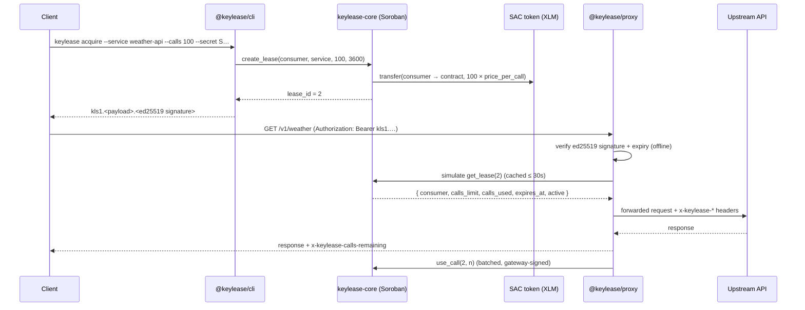
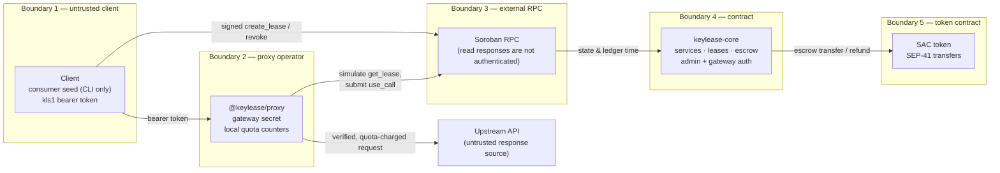

# Architecture and threat model

This document explains how the KeyLease gateway is put together, which
components are trusted with what, and what the existing security controls do —
and do not — guarantee. It is descriptive: it documents the implementation in
this repository, not a promise of properties the code does not provide.

The project is **pre-1.0 and has not been independently audited** (see
[SECURITY.md](../SECURITY.md)).

## Components and trust boundaries

The request-path diagram and the numbered component walkthrough are kept in
the README's [Architecture](../README.md#architecture) section. The same path
as a sequence of calls:

The five trust boundaries, plus the untrusted upstream response source:

### 1. Client (untrusted)

The client is a developer machine or CI job holding:

- the **consumer secret seed**, used by `@keylease/cli` to sign
  `create_lease`/`revoke` transactions and to mint `kls1` session tokens, and
- the **session bearer token** itself.

Nothing about the client is trusted. The proxy never sees the seed; it only
accepts a token whose ed25519 signature verifies against the `consumer` public
key embedded in the token, and then asks the chain whether that consumer
actually owns the referenced lease. A client can always spend its own lease,
replay its own token, share it, or waste its own quota — that is inherent to a
bearer credential.

### 2. Proxy (trusted for accounting, not for custody)

`@keylease/proxy` reads its configuration from the environment, verifies
requests and forwards them. It holds:

- `KEYLEASE_GATEWAY_SECRET` — the Stellar seed of the account registered on
  chain as `gateway`; used only to sign `use_call` transactions, and
- in-memory lease state, local per-lease counters and the pending quota batch.

The proxy is trusted to *account for usage honestly*. It is **not** trusted
with funds: it has no key that can move escrow (that requires the consumer's
`revoke` or the deterministic `settle`). A compromised proxy can over-serve,
under-report or burn quota, but it cannot withdraw the escrowed balance.

### 3. Soroban RPC (external, untrusted responses)

The proxy and CLI talk to a Soroban RPC endpoint over HTTPS
(`KEYLEASE_RPC_URL`, or the network default). The RPC returns simulated read
results and submits signed transactions. Nothing in the response is
cryptographically authenticated by the proxy, so the RPC is a trusted *path*
for correctness, not a trusted *authority*: it can lie, stall or censor within
the cache TTL. It cannot forge a transaction signature or spend escrow — the
contract checks authorization and the ledger is the source of truth at
settlement.

### 4. KeyLease contract (on-chain trust anchor)

`contracts/keylease-core` is the authority for service registration, lease
ownership, `calls_used`, lease state and escrow release. It enforces
`require_auth` on every state-changing entry point and holds escrow at its own
contract address. Its correctness (and the admin key) is the system's root of
trust; a bug or a compromised admin key is not mitigated by anything else.

### 5. SAC token (asset contract)

The escrow asset is a SEP-41 token whose address is fixed by `init` and has no
setter. Settlement and revocation transfer from the contract address with
`token::Client::transfer`. The contract does not inspect token internals beyond
the SEP-41 interface; the operator is responsible for initialising with the
intended asset (the native SAC in the shipped deployment).

### Upstream API (untrusted response source)

The upstream is only reached after verification succeeds. Its response status,
headers and body are relayed to the client mostly as-is (hop-by-hop headers are
dropped, `set-cookie` is preserved, `x-keylease-*` is set by the proxy). The
proxy is not a content filter or a trust boundary for upstream data.

## Assets

| Asset | Where it lives | Who can affect it |
| --- | --- | --- |
| **Escrow funds** (`price_paid` per lease, held by the contract) | SAC balance of the contract address | Released only by `settle` (permissionless after expiry/exhaustion) or `revoke` (consumer auth); split deterministically between provider and consumer |
| **Quota accounting** (`calls_limit`, `calls_used`, `calls_committed` events) | Contract persistent storage, mirrored by the proxy's cache and local counters | Advanced on chain only by the `gateway` account; counted locally by each proxy instance |
| **Consumer keys and credentials** (Stellar secret seed, `kls1` token, `.keylease/sessions.json`) | Client machine / CI secret store; tokens travel in `Authorization` headers | The holder; the CLI writes the session store with mode `0600` but does not encrypt it |
| **Operator credentials** (`gateway` seed, `admin` key) | Proxy environment / deployment secret store | Their holders; a leaked gateway key can burn quota but not move escrow; a leaked admin key can rotate the gateway |
| **Service registry** (provider, `price_per_call`, `active`) | Contract persistent storage | Any funded account can (re)register a service id with its own auth via `register_service`; `set_service_active` is limited to the recorded provider |

## Attacker model

The threats below are the ones the implementation is designed around. For each
one: where it is enforced, and what remains.

### Token forgery

*Threat:* an attacker mints or edits a `kls1` token to ride someone else's
lease.

*Enforced:* `verifySessionToken` parses `kls1.<payload>.<signature>`, requires
a 64-byte ed25519 signature and verifies it over the exact transmitted payload
segment against the `consumer` public key in that payload. A payload claiming
another consumer must carry that consumer's signature, so forgery requires the
consumer's secret key. Version, structure, `iat`/`exp` and public-key validity
are checked before any RPC call.

*Not guaranteed:* the token payload is self-asserted. Verification only proves
"this consumer key signed this lease id and window". The binding between
`lease_id` and `consumer` comes from the on-chain lease, checked separately
(failure → `403 consumer_mismatch`). There is no revocation list: a token stays
valid until `exp` even if the lease is revoked — the lease check is what stops
it, bounded by the cache TTL.

### Unauthorized requests

*Threat:* a request without a valid credential reaches the upstream.

*Enforced:* every proxied route except `/healthz`, `/readyz` and optional
`/metrics` requires `Authorization: Bearer <token>`. Missing header → `401
missing_token`; wrong scheme → `401 invalid_token`; bad signature/malformed
token → `401 invalid_token`; expired token → `401 token_expired`. After the
offline check the proxy requires the lease to exist, be active, be unexpired,
belong to the token's consumer, and have calls remaining. Denials are returned
before the upstream is contacted.

*Not guaranteed:* the token is not scoped to a service or a path. Any allowed
token is forwarded to any path the proxy serves, and the proxy forwards the
request path unchanged. Per-service isolation is a deployment property: run a
proxy instance per upstream/service. `/healthz`, `/readyz` and `/metrics`
(when enabled) are intentionally unauthenticated.

### Quota bypass

*Threat:* serve more calls than the lease pays for, e.g. by running several
proxies or restarting one.

*Enforced:* two layers. Locally, `LeaseVerifier` refuses once
`max(calls_used, local_calls) >= calls_limit` and decrements
`x-keylease-calls-remaining` per served call. On chain, the gateway commits
batches with `use_call`, so `calls_used` is shared by every instance and is
what settlement is computed from. Without a gateway secret the proxy states
plainly that it enforces quota locally only.

*Not guaranteed:* the local counter and the batched sink are not atomic with
the on-chain value. Calls buffered between commits (default batch 50, flush
every 10 s) are not yet visible to other instances, so `N` concurrent proxies
can each serve up to the cached remaining count inside `KEYLEASE_CACHE_TTL_MS`
(30 s default). Pending counts live in memory: a crash loses them, and a
shutdown flush that cannot reach the RPC leaves them uncommitted. Commits are
at-least-once: an ambiguous failure requeues the count, which can double-count
and shift settlement toward the provider. `use_call` clamps at `calls_limit`
rather than rejecting, so an over-commit burns the rest of the lease instead of
erroring — a compromised gateway can deny service to a consumer, but cannot
move escrow.

### Escrow manipulation or unauthorized payout

*Threat:* pay a provider twice, drain more than `price_paid`, settle an active
lease, refund a revoked one, or redirect funds.

*Enforced:*

- `create_lease` requires the consumer's auth and pulls
  `calls × price_per_call` via the SAC token into the contract; `price_paid` is
  captured at creation, so later re-pricing cannot change an existing lease.
- `settle` is permissionless but only succeeds once the lease is expired or
  exhausted (`LeaseNotSettleable` otherwise), and only once
  (`AlreadySettled`) thanks to the `settled` flag.
- `settle` pays `price_paid × calls_used / calls_limit` to the recorded
  provider and `price_paid − payable` to the recorded consumer, then marks the
  lease inactive and settled. `revoke` does the same split for unused calls,
  requires the consumer, and also sets `settled`.
- `payable + refund` is always exactly `price_paid`; the contract never holds an
  admin or gateway path that transfers escrow, and `init` can run only once.
- Committing more calls cannot overflow (`saturating_add` + clamp).

*Not guaranteed:* integer division truncates, so the provider's pro-rata share
can be short by less than one token unit (the remainder goes to the consumer);
no rounding rule is promised beyond "the split sums to `price_paid`". Escrow
safety also depends on the token contract behaving like SEP-41 and on the
contract code itself being correct — neither is verified at runtime.

### Malicious or compromised clients

*Threat:* abuse the proxy or the chain with a legitimate credential.

*Enforced:* a client can only act inside its own lease: it cannot consume
another consumer's quota (`consumer_mismatch`), cannot commit quota (gateway
auth), cannot settle early, and cannot revoke another consumer's lease. Body
size (`KEYLEASE_MAX_BODY_BYTES`), concurrency (`KEYLEASE_MAX_INFLIGHT`, shed
with `503` before quota is charged), request timeouts and upgrade rejection
(`426` before verification) bound resource abuse. Client-supplied
`x-keylease-*` and `x-forwarded-*` headers are stripped and rebuilt.

*Not guaranteed:* a token is a bearer credential — anyone who obtains it can
spend the lease until `exp`, and a token is reusable (no nonce). A client can
deliberately exhaust its own lease or abandon requests; once verification
succeeds the call is charged even if the client disconnects. A client can call
any path on the configured upstream (see above).

### Untrusted or compromised upstream components

*Threat:* the upstream API is hostile or breached and attacks the proxy, the
client or the escrow.

*Enforced:* the upstream is never reached before verification, so it cannot
trigger quota consumption or token checks. Hop-by-hop headers and
`Transfer-Encoding`/`Content-Length` are not forwarded verbatim; the proxy
re-frames the body and the response. The upstream does not receive the bearer
token unless `KEYLEASE_FORWARD_AUTH=true`.

*Not guaranteed:* upstream response bodies are buffered and relayed as-is
(status, headers, body) and are not validated; a malicious upstream can return
arbitrary content, large bodies, or redirect clients. Upstream compromise
cannot move escrow, but it can influence what clients believe the paid service
returned.

### RPC and transaction risks

*Threat:* a malicious, stale or unavailable RPC endpoint causes wrong
authorization decisions, lost quota commits, or transaction replay.

*Enforced:* lease reads are simulations of `get_lease` (the ABI), not raw
storage reads, and contract errors are mapped to precise HTTP decisions
(`Error(Contract, #5)` → `403 lease_not_found`). Results are cached for at most
`KEYLEASE_CACHE_TTL_MS` and never past the lease's own expiry. If the RPC
cannot be reached, decisions fail closed with `503 verification_unavailable`
(and `Retry-After`), and pending quota commits retry with bounded exponential
backoff and jitter (5 attempts).

*Not guaranteed:* RPC responses are unauthenticated and can be stale or false;
within the cache TTL a lying RPC can cause an incorrect allow/deny. Fail-closed
behaviour protects quota, not availability. Ledger close time is what the
contract uses for expiry while the proxy compares against local wall clock, so
clock skew can allow a request slightly past on-chain expiry (or deny one
early); committed calls after expiry fail with `LeaseExpired` and are never
committed once the retry budget is exhausted, under-reporting usage near
expiry. A transaction
whose result is ambiguous is retried (at-least-once), which can double-count.
Transaction fees are paid by the gateway account.

## Why the controls are shaped this way

- **Access is prepaid on chain.** `create_lease` is not a registry write: it
  transfers `calls × price_per_call` of the configured SAC token from the
  consumer into the contract's escrow. A lease therefore cannot exist without
  the consumer having paid for it, and the provider cannot be paid twice.
- **Settlement is deterministic.** `settle` (permissionless after expiry or
  quota exhaustion) pays `provider = price_paid × calls_used / calls_limit` and
  refunds the remainder to the consumer. `revoke` does the same for the unused
  calls immediately, with the consumer's authorisation.
- **Quota is enforced on chain, not just in memory.** A proxy's local counter
  is only a fast path; running a second proxy would otherwise mint free quota.
  The gateway account commits served calls with `use_call`, so `calls_used` on
  chain reflects real traffic and every instance sees the same remaining quota.
- **The signature check is offline.** A bearer token is
  `kls1.<base64url(payload)>.<ed25519 signature>` where the payload carries
  `(v, lease_id, consumer, iat, exp)` and the signature is produced by the
  consumer's Stellar key. Forged or expired tokens never reach the RPC layer.
- **Reads go through simulation.** Lease state is read by simulating
  `get_lease` over Soroban RPC rather than poking at raw contract storage, so
  the proxy follows the contract's ABI instead of its storage layout, and
  contract errors (`Error(Contract, #5)`) map to precise HTTP decisions.
- **Long-lived entries are bumped.** Leases and services are persistent
  entries whose TTL is extended on every write **and** every read, so a lease
  does not disappear from state while it is still payable, even if it is only
  ever read (the proxy's `get_lease` path).

## Security control summary

| Control | Guarantees | Does not guarantee |
| --- | --- | --- |
| Offline ed25519 token verification | Tokens are unforgeable without the consumer key; malformed or expired tokens are rejected before RPC/upstream use | That the consumer owns the lease (chain check does), or single use (bearer, replayable until `exp`) |
| Simulated `get_lease` + short cache | Decisions follow the contract ABI; stale state is bounded by the TTL and lease expiry; contract errors map to stable HTTP codes | That the RPC answered truthfully or that state is current at the instant of the request |
| On-chain quota via `use_call` | Shared, settlement-relevant usage counter that a single restarted proxy cannot reset; gateway auth required | No overshoot inside the batch/cache window; no loss on crash; no double-count on ambiguous retries; no protection at all if `KEYLEASE_GATEWAY_SECRET` is unset |
| Contract authorization | `set_service_active` requires the recorded provider; only the consumer creates/revokes its lease; only the gateway commits calls; admin rotation is two-step | That a service id cannot be re-registered by another account (see below); that the admin or gateway key is uncompromised; that the contract has no bug |
| Escrow invariants | At most `price_paid` leaves escrow per lease, once, split between the recorded provider and consumer; no admin sweep | Exact pro-rata rounding to the smallest unit, nor the value of a non-SEP-41 or wrong token chosen at `init` |
| SAC settlement transfers | Funds move only from the contract to the provider/consumer recorded in the lease | Protection against a malicious token contract or a ledger-level failure during transfer |

## Known limitations

- Tokens are not bound to a service, path or call count; the lease's on-chain
  `calls_limit` is the only quota bound.
- Without `KEYLEASE_GATEWAY_SECRET`, quota is enforced only by the proxy
  instance that received the request, and `calls_used` never advances, so
  settlement pays the provider nothing for calls the proxy served.
- `set_service_active` gates new leases only: existing leases, and the proxy
  (which reads only lease state), keep working while a service is paused.
- `register_service` is an upsert keyed by the service id: any funded
  account can create, re-price or repoint a service name, including one that
  another account already registered. A lease stores `provider` and
  `price_paid` at creation, so existing escrow and payouts are unaffected, but
  consumers who acquire after such a takeover pay the new provider.
- Denial decisions, counters and the pending quota batch are in memory per
  process; there is no shared store between proxy instances.
- `/healthz`, `/readyz` and `/metrics` (when enabled) are unauthenticated.

## Related reading

- [README](../README.md) — quickstart, configuration and response reference.
- [SECURITY.md](../SECURITY.md) — reporting and scope.
- [`contracts/keylease-core`](../contracts/keylease-core/src/lib.rs) — contract
  entry points, errors and escrow logic.
- [`packages/proxy/src/verifier.ts`](../packages/proxy/src/verifier.ts) — token
  and lease verification decisions.
- [`packages/proxy/src/quota.ts`](../packages/proxy/src/quota.ts) — batched
  on-chain quota commits.
