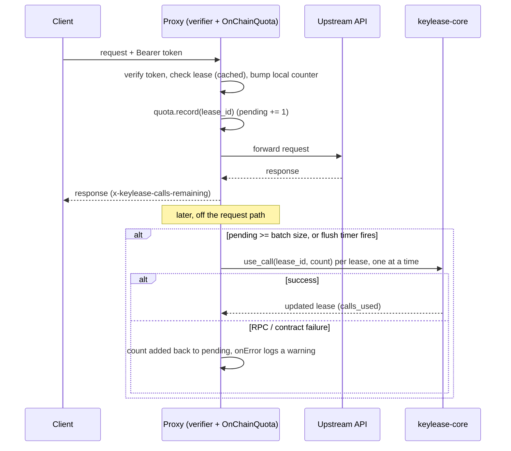

# Quota batching: semantics and failure modes

How `@keylease/proxy` counts calls and commits them to the `keylease-core`
contract (`packages/proxy/src/verifier.ts`, `packages/proxy/src/quota.ts`).

## Two counters

1. **Local counter (fast path).** Every allowed request increments an in-memory
   counter in the proxy process. The proxy refuses a call when
   `max(calls_used from the cached lease state, local counter) >= calls_limit`
   (`403 quota_exhausted`). It costs no RPC call.
2. **On-chain `calls_used` (source of truth).** When `KEYLEASE_GATEWAY_SECRET`
   is set, each served call is also queued and later committed with the
   gateway-signed `use_call(lease_id, count)`. Settlement pays the provider from
   the on-chain `calls_used`.

Without `KEYLEASE_GATEWAY_SECRET` nothing is committed: quota is enforced only
by the local counter and on-chain `calls_used` stays where it was until
settlement.

## The commit path

Commits are **batched and fire-and-forget**. The request path never waits for
the chain, and a failed commit is never turned into an error for the caller.

Note that the call is recorded when it is **admitted**, before the upstream
responds, so calls that end in an upstream error still count.

## Batch size, interval and retries

| Setting | Variable | Default | Behaviour |
| --- | --- | --- | --- |
| Batch size | `KEYLEASE_QUOTA_BATCH` | `50` | A flush starts as soon as the **total** pending calls, summed over all leases, reach this number. |
| Flush interval | `KEYLEASE_QUOTA_FLUSH_MS` | `10000` | A timer flushes whatever is pending. The timer does not keep the process alive. |

- Flushes are serialised, so two commits never overlap. Within one flush each
  lease is committed with its own `use_call(lease_id, count)` transaction.
- **Retry:** if a commit fails, its count is put back into the pending map and is
  sent again by a later flush (the next batch-size trigger or the next timer
  tick). There is no backoff, no attempt limit and no persistence; the failure is
  reported only as a warning log (`on-chain quota commit failed; calls requeued`).
  A failing lease does not stop the other leases in the same flush.
- On graceful shutdown (`close()`) the timer is stopped and one final flush runs.
  If that last flush fails, the pending counts are lost with the process.

## Crash and restart window

Pending counts live only in memory. If the proxy is killed (SIGKILL, OOM, host
loss) or its final flush fails, the calls that were served but not yet committed
are never written on chain. With the defaults that is up to roughly 49 calls
plus whatever was in flight or was requeued after RPC failures, and up to about
10 seconds of traffic below the batch threshold. While Soroban RPC is
unavailable the pending set keeps growing in memory.

Consequences:

- On-chain `calls_used` can **under-report** real usage, so settlement pays the
  provider for fewer calls than were served and refunds the consumer the
  difference. The contract clamps `calls_used` at `calls_limit`.
- After a restart the local counter starts at zero. The proxy then relies on the
  chain's `calls_used`, read through the lease-state cache (default 30 s TTL,
  `KEYLEASE_CACHE_TTL_MS`). A consumer can therefore briefly obtain calls the
  lost commits should have consumed.

## Reconciling with `use_call`

`use_call` is gateway-only: it requires authorisation from the account stored as
`gateway` in the contract config. To reconcile after a crash, compare the
number of calls your upstream actually served for a lease (for example from the
upstream's own logs, or from the `x-keylease-lease-id` header it receives) with
`calls_used` from `get_lease`, then have the gateway account submit
`use_call(lease_id, missing)` for the difference. The CLI `status --lease <id>`
command reads the current on-chain state. Constraints from the contract:

- `count` must be greater than zero.
- It fails with `LeaseInactive` for a revoked or settled lease and with
  `LeaseExpired` once the lease's `expires_at` has passed. Reconcile **before**
  the lease expires and before anyone calls `settle`; afterwards the missing
  calls can no longer be committed.

This document does not describe an automated reconciliation tool; none exists in
the repository.

## Two proxy instances on one lease

Each instance keeps its own local counter and its own pending batch. They
coordinate only through the chain:

- Each instance's commits raise the shared on-chain `calls_used`, and each
  instance takes `max(on-chain calls_used, own local counter)`, so the two do not
  double count.
- The view of the other instance's traffic is delayed by its batch/flush delay
  plus this instance's lease-state cache TTL. During that window both can admit
  calls, so the lease can be over-served by up to roughly the other instance's
  recent traffic. The contract clamps the committed total at `calls_limit`, so
  the provider is never paid for more than the limit, but the extra calls were
  already served.
- Keep the batch size and flush interval small (and set a short
  `KEYLEASE_CACHE_TTL_MS`) when several proxies share leases and tight quota
  enforcement matters; larger values reduce RPC load at the price of a wider
  window.
- Running several instances without `KEYLEASE_GATEWAY_SECRET` gives every
  instance an independent counter, so the effective quota is multiplied by the
  number of instances.
